# RhinoTiger（犀虎）

[English](MANUAL.md)

RhinoTiger は、M-VAVE FM-1 のための、ダークサイからハイテックまでの自動生成サイケトランス・ファームウェアです。音楽はひとりで鳴ります。
あなたは舵を取ります。4つのマクロノブ、ミュート付きのミックス、そして音楽に一発ものの音を投げ込む鍵盤で。
キック、転がる FM ベース、パーカッション、くり返すライン、一発ものの音、持続するアトモスが、16分音符の格子の上で鳴ります。
遅く湿ったものから速く細かいものまで8つの世界があり、それぞれの振る舞いを決めます。

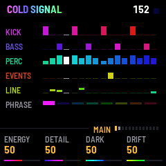

---

## 目次

1. インストール
2. 起動
3. 画面
4. 操作
5. ページ
6. 鍵盤
7. パフォーマンス
8. セクション
9. 世界
10. 保存
11. MIDI
12. USB オーディオ
13. 困ったとき
14. ライセンス

---

## 1. インストール

まず試すなら、[エミュレーター](../emu/)を開いてください。同じコードがブラウザで音つきで動きます。

ブラウザからインストールするには、Chrome か Edge を使います。FM-1 を USB でつなぎ、[インストーラー](../install/)を開いて
Install を押します。ブラウザが MIDI の許可を一度だけ尋ねるので、許可してください。書き込み中はケーブルを
抜かないでください。

ターミナルからは、パッケージをダウンロードし、ソースの中で
`python3 base/tools/fm1_install.py rhinotiger-VERSION.fwsc` を実行します。

RhinoTiger が保存するのは自分の設定だけです。ほかのファームウェアが保存したもの（プロジェクト、プリセット、
サンプル）は読みません。そのファームウェアに戻ったときに残っているとも限らないので、先にバックアップしてください。

インストールは自己責任です。M-VAVE 純正のファームウェアに戻すには、インストーラーの「Back to the stock firmware」を使います。
M-VAVE のファームウェア（FM-1.fwsc）をダウンロードし、そこで選んでボタンを押します。

---

## 2. 起動

FM-1 を起動するとロゴが出て、消えると、保存してある設定で音楽がひとりでに始まります（10. 保存 を参照）。

待たずに始めるなら、ロゴが出ている間に PLAY を押します。

音楽はまばらに始まり、パートがひとつずつ入ってきて、やがて全部がそろいます。

PLAY で休みます。もう一度押すと、またまばらに始まります。

---

## 3. 画面

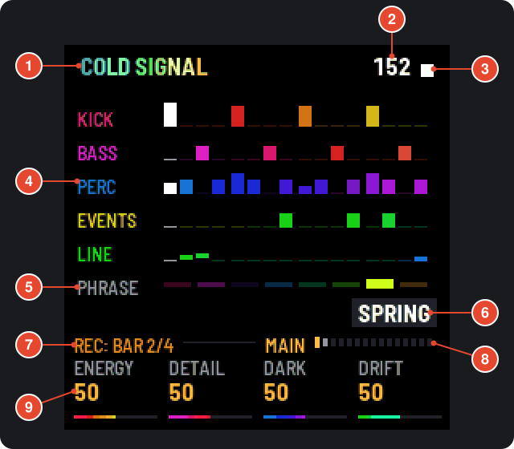

1. **世界の名前**（9. 世界 を参照）。鳴っている間は色が拍ごとに右へ流れ、休んでいる間は灰色です。ノブを回したりボタンを押したりした直後は、しばらくここに、何が起きたかが出ます。
2. **テンポ**。1分あたりの拍数です。
3. **拍のランプ**。拍ごとに点滅し、小節の頭では白く光ります。
4. **レーン**。KICK、BASS、PERC、EVENTS、LINE の5段が、いま鳴っている小節を、16分音符ひとつにつき1マスで見せます。背の高い塊ほど強い打ち、点は休み、白いマスがいま鳴っている16分音符です。ラインは音の高さで描かれます。開いているページのパートがいちばん明るく、ミュートしたパートは暗くなります。
5. **フレーズ**。8本の棒が8小節で、いま鳴っている小節が光ります。ブレイクやビルドの間は、そのセクションの小節を数えます（8. セクション を参照）。セクションを呼ぶと、次の小節まで `BREAK >`、`BUILD >`、`DROP >` と出ます。
6. **投げた音**。鍵盤から投げた一発ものの音の名前です（6. 鍵盤 を参照）。
7. **ルールの左**。ALGORITHM で選んだものの名前が出ます（4. 操作 を参照）。ほかに、REC が待っている間は `REC: NEXT BAR`、取り込んでいる間は `REC: BAR 2/4`（6. 鍵盤 を参照）、AUTO PLAY の間はたった時間（5.5 を参照）、GLOBAL で保存していないものがあるときは `SAVE: KEEP IT` が出ます。
8. **ページ**。開いているページの名前と、15ページぶんの小さな棒です。開いているページの棒が明るく光ります。
9. **ノブ**。K1〜K4 の名前、値、細い棒です。回したばかりのノブは明るくなります。

レーンの代わりに別の絵が出るページが2つあります。MIX は6本のストリップのミキサー（5.13 を参照）、ECHO は16のエフェクトと6つのパートの格子です（7. パフォーマンス を参照）。

色は音楽につれて動きます。色相がゆっくり一緒に揺れ、ブレイクでは沈み、ビルドではだんだん速く回り、ドロップで跳びます。
パレットは GLOBAL の THEME で選びます（5.15 を参照）。

ボタンはどれも暗く光り、開いているページのボタンは明るく光ります。ほかのボタンは、次のときに光ります。光の強さは GLOBAL の LIGHTS で決めます（5.15 を参照）。

| ボタン | 光るとき |
| --- | --- |
| PLAY | 鳴っている間 |
| SAVE | ブレイクが呼ばれているか、続いている間。GLOBAL では、保存していないものがある間 |
| ARP | ビルドかドロップが呼ばれている間。ビルドの間は拍ごとに点滅 |
| REC | 次の小節を待つ間はすばやく点滅、取り込んでいる間は拍ごとに点滅、鍵盤のループが鳴っている間は点灯 |
| OCT− | 鍵盤のオクターブが0より下の間 |
| OCT+ | 鍵盤のオクターブが0より上の間 |

---

## 4. 操作

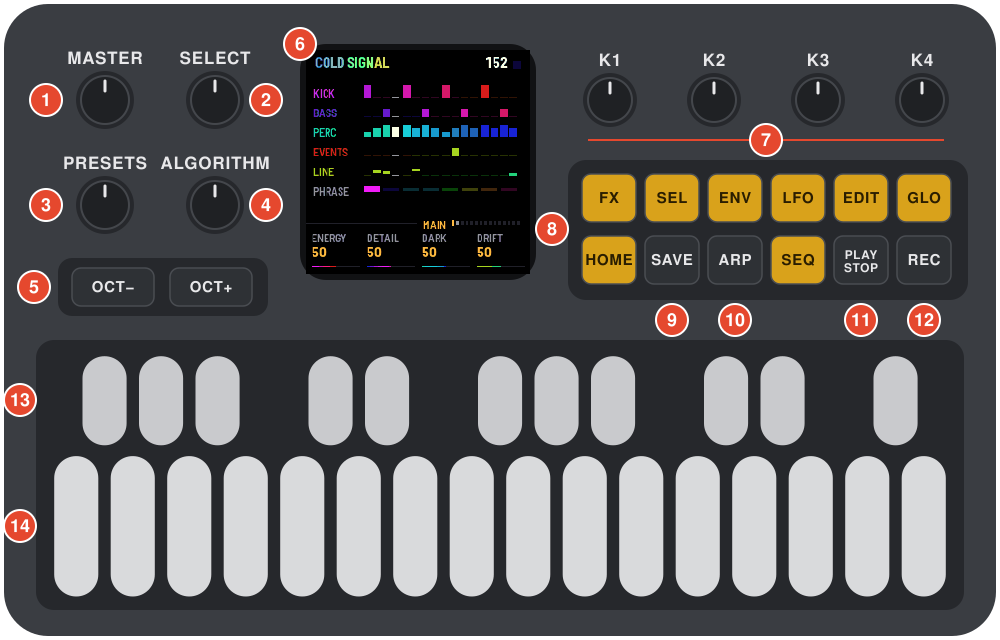

### ページを開く

**SELECT（2）を回すと、15のページを MAIN から GLOBAL まで順に巡ります。** どのページも、これで開けます。端で止まります。

**色をつけたボタン（8）は、ページへのショートカットです。** 押すとそのページへ飛び、続けて押すと、同じボタンのページを順に切り替えます。

| ボタン | ページ |
| --- | --- |
| HOME | MAIN、GROOVE |
| SEQ | BREAK、BUILD、AUTO |
| SEL | KICK、BASS |
| ENV | PERC、EVENTS |
| LFO | LINE、LINE SEQ、ATMOS |
| EDIT | MIX |
| FX | ECHO |
| GLO | GLOBAL |

LFO だけは、LINE と LINE SEQ で半秒押し続けると、ページは動かずに、次の小節からラインのフレーズが描き直されます（5.10 を参照）。

### そのほかの操作

| 番号 | 操作 | 働き |
| --- | --- | --- |
| 1 | MASTER | 音量。 |
| 3 | PRESETS | 世界を選びます。8つあり、端まで行くとぐるりと回ります。次の小節から新しい世界になります（9. 世界 を参照）。 |
| 4 | ALGORITHM | 開いているページの種類を選びます（下を参照）。 |
| 5 | OCT− · OCT+ | 鍵盤のオクターブを1つずつ動かします。1つ下から2つ上まで（6. 鍵盤 を参照）。 |
| 7 | K1〜K4 | 開いているページの4つのノブ。範囲の広いノブ（0〜100 と FEEDBACK）は、ゆっくり回すと1刻みで1ずつ、速く回すと2ずつ、さらに速いと4ずつ動きます。 |
| 9 | SAVE | ブレイクを呼びます（8. セクション を参照）。GLOBAL でだけは保存のボタンで、軽く押すとすべてを保存、1.5秒押し続けると初期値に戻します（10. 保存 を参照）。 |
| 10 | ARP | ビルド、そしてドロップを呼びます（8. セクション を参照）。 |
| 11 | PLAY | 鳴らす、または休む。休んだあとは頭からやり直します。 |
| 12 | REC | 軽く押すと、次の小節から、鍵盤が投げたものが最大4小節のループに取り込まれます。取り込んでいる間に押すとそこで終わり、長押しでループが消えます（6. 鍵盤 を参照）。 |
| 13 | 黒鍵 | 押している間、白鍵がそのリズムで音を投げます（6. 鍵盤 を参照）。ECHO ページでは、パートの操作です（7. パフォーマンス を参照）。 |
| 14 | 白鍵 | 音楽に一発ものの音を投げ込みます（6. 鍵盤 を参照）。ECHO ページでは、エフェクトです（7. パフォーマンス を参照）。 |

ALGORITHM はページによって働きが違います。選んだものの名前はルールの左に出ます。それぞれの種類や形は、各ページで紹介します。
これらは保存されません（10. 保存 を参照）。

| ページ | ALGORITHM で選ぶもの |
| --- | --- |
| MAIN | キットを回します。進めると、鳴っているパートのうちひとつか数個が、次の小節から別の種類になります。一小節のうちに多く回すほど多く変わり、最大3パートまで。戻すと、ひとつ前のキットへ（8回前まで）。 |
| GROOVE | ベースの形。 |
| KICK、BASS、PERC、EVENTS、LINE、LINE SEQ、ATMOS | そのパートの種類（5つか6つ）。そのパートの次の音から変わります。 |
| MIX | TRACK で選んでいるパートの種類。 |
| ECHO | エコーの種類。 |
| BREAK、BUILD、AUTO、GLOBAL | 何もしません。 |

---

## 5. ページ

15あります。4つのノブはいつも開いているページのものです。各ノブについて、回すと何が聞こえるかを書きます。括弧の中は初期値です。パートの音量と
エコーへの送りは、MIX にだけあります（5.13 を参照）。

### 5.1 MAIN

4つのマクロです。それぞれが音楽のいくつかのことを一度に傾け、真ん中が中立です。50 なら世界のままです。

- ENERGY（初期値: 50）: にぎやかか、まばらか。上げると一発ものの音が増え、ラインが賑わい、ハットが増え、休むパートが減ります（GROOVE を参照）。
  下げると薄くなります。
- DETAIL（初期値: 50）: 細かいか、素朴か。上げると、一発ものの音の連打が増えて長くなり、高いところでは速くなり、ときどきハットに素早い2連打が入ります。
  下げると単発のままです。
- DARK（初期値: 50）: 暗く奇妙か、明るく素直か。上げるとベースが暗くなり、一発ものの音が低いほうと中ほうへ寄り、ざらつく音程が増え、ラインが半音で
  這い、高くまで届きます。下げると明るく開けます。
- DRIFT（初期値: 50）: 勝手にどれだけ変わるか。上げると、フレーズごとに一発ものの音がより多く描き直され、ベースがより大きく開閉し、ラインがより多く書き換えられ、
  ブレイクが勝手に来る頻度が増え（8. セクション を参照）、ドロップでベースの種類が変わることも増えます。また、FILLS、GAP、ブレイクとビルドの
  LENGTH が、ひとつ短いほうか長いほうへ外れることも増えます（GROOVE、BREAK、BUILD を参照）。0 ではひとりでは何も動かず、ブレイクも勝手には
  来ず、それらの長さはぴったりになります。

ALGORITHM でキットが回ります。BREAK の MORPH で、ときどきひとりでにも回ります。変わったものは、ヘッダーにしばらく出て、それぞれの種類がそのパートの色で出ます。

### 5.2 GROOVE

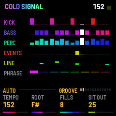

グルーヴの土台です。速さ、根音、フィル、パーカッションの休み。

- TEMPO（初期値: 世界のまま）: 速さ。1分あたりの拍数で出ます。世界のテンポから最大20、速くも遅くも動かせます。
- ROOT（初期値: 世界のまま）: ベースとキックの土台になる音。音名で出ます。最大で半音5つ下、6つ上へ動かせます。
- FILLS（初期値: 8）: 小節の最後の拍がフィルになる頻度（ベースが休み、クラップが駆け上がります）と、フレーズの終わりにキックがひねりを入れる頻度。
  OFF、または32、16、8、4小節ごと。これはふだんの間隔で、しばらくその半分や倍になることがあります。DRIFT が高いほど多く。
  フィルはいつも、4、8、16、32小節の区切りの終わりに入ります。
- SIT OUT（初期値: 25）: パーカッション（ハット、オープンハット、クラップ、ライド）のどれかが、フレーズひとつぶん休む頻度。0 なら休みません。

ALGORITHM でベースの形を選びます。新しい形は次の小節から始まります。

| 形 | 鳴り方 |
| --- | --- |
| AUTO | 世界に任せます。拍ごとにキック、そのあとの3つの16分音符でベースが転がり、ときどきギャロップ、裏拍、3連の小節が入ります（3連は入る世界だけ）。 |
| K-B-B-B | 転がりのまま。 |
| GALLOP | ギャロップのまま。 |
| OFFBEAT | 裏拍のまま。 |

### 5.3 BREAK

ブレイクのページです。ブレイク、ビルド、ドロップを、音楽がひとりでどう進むか、そして音色がひとりでどう変わるか。自分で呼ぶには SAVE と ARP を押します（8. セクション を参照）。

- BREAKS（初期値: 50）: ブレイクが勝手に来る頻度。0 では CUED と出て、呼んだときしか来ません。上げるほど頻繁で、DRIFT の影響も受けます。
- LENGTH（初期値: WORLD）: 勝手に来たブレイクのふだんの長さ。WORLD は世界に任せ、または 4、8、16、32小節。ときどき、その半分か倍の長さになります。DRIFT が高いほど多く。
- GAP（初期値: 64）: ドロップから、次の勝手なブレイクまでの最短の小節数。32、64、96、128。ドロップによっては、ひとつ短いか長くなります。DRIFT が高いほど多く。
- MORPH（初期値: 40）: キットがひとりでに変わる頻度。MAIN で ALGORITHM を回したときのように、パートのひとつか数個が別の種類になります。
  ドロップのときと、グルーヴが長く続くときは32小節ごと（その半分の頻度）に起きることがあります。上げるほど頻繁で、一度に変わるパートも増えます。
  変わったものはヘッダーに出ます。0 では ALGORITHM を回したときしか変わりません。

### 5.4 BUILD

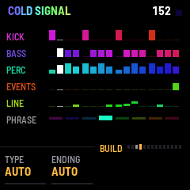

どんなビルドが来て、どう終わるか。どのビルドにもライザーがつきます。

- TYPE（初期値: AUTO）: ビルドの種類。AUTO は、世界の好みに沿って毎回ほかのどれかを選びます。続けて同じものにはなりません。
- ENDING（初期値: AUTO）: ビルドの最後の小節で何が起きるか（FAKE では、短いドロップの前の小節）。AUTO は毎回ほかのどれかを選び、続けて同じものにはなりません。
- LENGTH（初期値: 4）: ふだんのビルドの長さ。2、4、8小節。ときどき、ひとつ長いビルドになり、それよりまれに、ひとつ短いビルドになります。どちらも DRIFT が高いほど多く。

ビルドが鳴っている間は、ルールの左に `NOW` と、いま鳴っている種類と終わり方が出ます。AUTO が何を選んだかがわかります。

| TYPE | 鳴り方 |
| --- | --- |
| ROLL | キックとベースが抜け、クラップが4分、8分、16分と転がります。 |
| KICK | キックが同じように転がり、1オクターブ上がります。ベースは抜けます。 |
| FILTER | キックは残り、パーカッションは2つめの4分から、ベースは半ばから入り、ベースは下を削られ、ハットは強くなります。 |
| TRIPLET | クラップが4分、8分3連、16分3連と上がるように転がります。 |
| STUTTER | グルーヴが続いたまま、だんだん小さな切れ端で繰り返されます。4分、8分、16分、32分。 |
| POLY | キックが小節に対して付点8分、やがて付点16分、そして16分へと詰まり、クラップは2拍めと4拍めに入ります。 |
| SINK | 逆向き。クラップが16分、8分、4分と遅く落ちていくように転がり、ほかは上から閉じていきます。 |
| FAKE | ROLL のあと、1拍だけのドロップが入って途中で切れ、1小節ぶんのクラップの16分があって、本物のドロップが来ます。 |
| HALF | グルーヴがハーフタイムに落ちます。キックは1拍めと3拍め、クラップは3拍め。ドロップで元の速さに戻ります。 |
| ACID | キックが抜け、ベースだけが16分で鳴り続け、3つめごとに1オクターブ上がります。ベースの噛みがどんどん開き、叫ぶようになります。ハットは裏拍に入ります。 |
| STAIRS | グルーヴは続いたまま、ベース、ライン、アトモスが、ビルドの4分の1ごとに短3度ずつ上がっていきます。 |
| GATE | グルーヴは続いたまま刻まれます。4分、8分、16分、32分と細かくなり、それぞれの前半だけが鳴ります。 |

| ENDING | 鳴り方 |
| --- | --- |
| BREATH | 最後の拍が無音になります。 |
| RUSH | 無音なし。最後の拍でロールが倍の速さになり、そのままドロップへ。 |
| VOID | 最後の小節が空になり、ライザーだけが残って、最後の拍は無音です。2小節のビルドでは最後の2拍。 |
| TAPE | 最後の2拍で、音楽がゆっくり止まります。 |
| REVERSE | 最後の拍で、その前の拍が逆回転で鳴ります。 |
| ECHO | 3拍めがエコーに投げ込まれ、最後の拍はその繰り返しだけが鳴ります。 |
| PICKUP | 最後の拍は無音ですが、最後の16分だけキックとベースが入り、ドロップへ踏み込みます。 |

### 5.5 AUTO

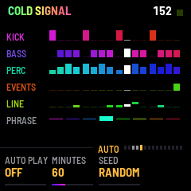

AUTO PLAY は、DJ のように、ひとつのセットをまるごとひとりで鳴らします。世界を渡り、テンポとキーを動かし、
ブレイクとビルドを呼び、独自の曲線に沿って音楽を高めたり静めたりします。エフェクトを弾き、パートを抜いては戻し、鍵盤のように音を投げます。

- AUTO PLAY（初期値: OFF）: 右で ON、左で OFF。
- MINUTES（初期値: 60）: セットの長さ。30、60、90分、または ENDLESS（終わりなし）。
- SEED（初期値: RANDOM）: どのセットか。1から99まで、番号ごとに別の組み立てです。世界、テンポ、キー、どこで高まりどこで静まるか。休んでいるところから始めれば、
  同じ番号、同じ MINUTES、同じテンポで同じ組み立てになります。その中で鳴る音は、毎回違います。RANDOM は番号をひとつ選び、セットの間はその番号が出ます。
- PERFORM（初期値: 50）: エフェクト、パートの抜き差し、鍵盤の音をどれだけ使うか。0 ではどれもあなたに任せます（章のつなぎ目やグルーヴの終わり、
  始まりでパートを抜くのは、セットの組み立てとして残ります）。

音楽が休んでいるときに ON にすると、セットは始まりで PLAY を待ちます。鳴っているときに ON にすると、そこから続けます。MINUTES と SEED を
回せるのは OFF の間だけです。PERFORM はいつでも回せます。MAIN、BREAK、AUTO では、ルールの左にセットのたった時間が `12:34`（1時間を超えると
`1:02:34`）のように出ます。その右のルールの線はバーになり、セットのどこまで来たかだけ光ります。線の目盛りは章の区切りです。ENDLESS
では、バーは1時間ごとに始めから進みます。

セットは、数分ずつの章でできていて、章はそれぞれ1曲のように進みます。いくつかのグルーヴがあり、それぞれ終わり方が違います。そのひとつが
章の「大きなブレイク」で、長いブレイクとビルドを経てドロップに入ります。ほかは、短いブレイクからすぐドロップ、グルーヴからそのままビルド、
パートを抜くかフィルターをかけて自分のドロップへ、のどれかです。いちばん高い章がセットの頂点で、そのブレイクはいちばん長く、ひとつ前の章は抑えられます。
セットの始まりも、少しずつ入ってきます。ラインとイベントは、ほかより少し遅れて入ります。

章から次の章へは、DJ が曲をつなぐように、3とおりのどれかで変わります。大きなブレイクを通って、ドロップで世界とキーが変わる。次の章のブレイクへ、
そのブレイクの始まりで世界とキーが変わる。グルーヴの中で、古い章が薄くなり（低音、ベース、キックが抜けていき）、ドロップで新しい世界とキーが来て、
新しい章がパートごとに入ってくる。世界とキーが変わるのは、ここだけです。テンポはずっとなめらかに動きます。
セットは、ON にしたときのテンポから始まります。休んでいるときは GROOVE の TEMPO で、鳴っているときはいまのテンポで（MIDI クロックがあれば
そのテンポで）、セットの速さを決められます。そのあとのテンポも全部、同じだけずれて動き、125〜206 BPM に収まります。
30、60、90分のセットは、最後のブレイクで静かに消えていき、音楽が休みます。
その最後のブレイクで ARP を押すと、AUTO PLAY は OFF になり、音楽がそのまま続きます。

章ごとに、いくつかの音と、その章の間くり返し現れる短いモチーフがあります。エフェクトとパートは、おもにフレーズの終わりで動きます。
その間は、レーンの代わりに ECHO ページのエフェクト（7. パフォーマンス を参照）が表示され、鳴っているエフェクトは明るく、抜けているパートは暗くなります。開いている
ページとそのノブ、鍵盤の働きは変わりません。何かに触ると、そのページの絵に戻ります。AUTO PLAY が弾いている鍵は、押したときと同じように光ります。
ECHO ページでは、暗いパートの黒鍵を押すと、そのパートが戻ります。ATMOS だけは切らずに、
ときどきゆっくり下げて、またゆっくり上げます。MIX のフェーダーも一緒に動きます（5.13 を参照）。

一緒に弾けます。セットが動かしているもの（MAIN の4つのノブ、TEMPO、ROOT、BREAKS、ビルドの LENGTH）を回すと、32小節のあいだあなたの
ものになり、そのあとセットに戻ります。MAIN の4つのノブと TEMPO は少しずつ、BREAKS と LENGTH は一度に、ROOT は次の章で戻ります（章が変わる直前に
回すと、次の章の間も続きます）。PRESETS で選んだ世界は、次の章まで続きます。呼んだブレイク、
ビルド、ドロップには、セットがついていきます（呼んだブレイクは、長くても32小節でビルドへ進みます）。大きなブレイクを通って変わる章の最後のブレイクかビルドでドロップを呼ぶと、次の章になります。エフェクトを自分で弾くと、32小節のあいだ、エフェクトとパートの抜き差しはあなたに任されます。パートを
ミュートするか戻すと、そのパートには同じだけ触らず、どれかがミュートされている間はパートを抜きません。ATMOS の LEVEL を回すと、
下がっていた ATMOS は戻り、同じだけ触られません。鍵盤で音を投げるか REC を押すと、
32小節のあいだと、REC のループが鳴っている間は、セットは音を投げません。ほかのものは、いつもどおりあなたのものです。

OFF にすると、音楽はそのまま続き、ノブはセットが置いたところに残ります。セットの間に SAVE で保存されるのは、セットの値ではなく、あなたの
設定です。セットが終わると、あなたの設定に戻ります。

### 5.6 KICK

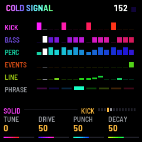

キックの音です。

- TUNE（初期値: 0）: キックの音程。半音6つまで下にも上にも。0 より上は + 付きで出ます。
- DRIVE（初期値: 50）: 歪ませる強さ。やわらかくきれいなものから荒いものへ。
- PUNCH（初期値: 50）: 出だしのクリックの鋭さ。
- DECAY（初期値: 50）: 胴の長さ。短く締まったものから、長く満ちたものへ。

ALGORITHM で種類を選びます。

| 種類 | 音 |
| --- | --- |
| SOLID | 世界のまま。 |
| HARD | 落ち方が速く、クリックが大きく、歪みも多い。 |
| KNOCK | 短く、ブーンの下に木が鳴る。 |
| ZIP | 高いところからゆっくり落ちる、暗いキックのジッ。 |
| CRACK | 速く落ちて締まり、上に明るいノイズがはじける。ハイテックのキックの破裂音。 |

### 5.7 BASS

転がる FM ベースの音です。

- BITE（初期値: 50）: 各音の出だしの噛みつき。丸いものから唸るものへ。
- DECAY（初期値: 50）: その噛みつきがどれだけ続くか。下げると丸く、上げると音の間ずっと唸りが残ります。
- LENGTH（初期値: 50）: 各音の長さ。短く弾ける音（世界の4分の1）から、音として許される限りの長さまで。
- DRIVE（初期値: 50）: ベースを歪ませる強さ。

ALGORITHM で種類（ベースの色）を選びます。たいていのドロップで、ひとりでほかのものに変わります。DRIFT が低いほど、同じまま続くことが増えます。

| 種類 | 音 |
| --- | --- |
| ROUND | 丸い、もとの音。 |
| BITTEN | 噛みつきが強い。 |
| METAL | 金属的で、倍音が音程からずれる。 |
| HOLLOW | 1オクターブ下の響きが混じる、太い音。 |
| SNAP | 各音の頭に硬いクリック、その下は丸い。 |
| NASAL | 中の空いた、鼻にかかったブザー。 |

### 5.8 PERC

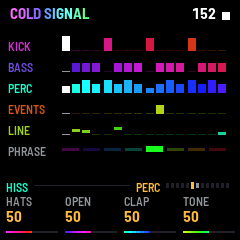

パーカッション（ハット、オープンハット、クラップ、ライド）です。

- HATS（初期値: 50）: 閉じたハットの音量と、弱い16分音符のどれだけが鳴るか。0 ではハットもオープンハットもありません。
- OPEN（初期値: 50）: オープンハットの響く長さ。世界の4分の1から4倍まで。
- CLAP（初期値: 50）: 2拍めと4拍めのクラップの音量。0 でなし。
- TONE（初期値: 50）: 50 より下ではパーカッション全体が暗くなり、0 でこもります。50 より上ではハットが細くなり、クラップの帯が上がります。50 はそのまま。

ALGORITHM で種類を選びます。

| 種類 | 音 |
| --- | --- |
| HISS | 世界のまま。 |
| TIN | 長く響く、小さな安物のシンバル。 |
| TICK | 短く細い、乾いたチック。 |
| GRIT | 階段状に粗くしたノイズ。機械のなかの埃。 |
| SEED | 低めの狭い帯のノイズがゆっくりふくらみ、まばらな粒でパラパラ鳴る。シェイカーの種。 |

### 5.9 EVENTS

イベントは、ダークサイやハイテックを形づくる一発ものの音です。ザップ、うがい音、ダイブ、唸り、さえずり、レーザーが、単発か、連なり（音程の
階段、ロール）で鳴ります。音楽は、裏拍に4小節ぶんのイベントをループとして持ち、フレーズごとにいくつかが変わります。鍵盤から
投げたものも、そこに加わります（6. 鍵盤 を参照）。

- DENSITY（初期値: 50）: どれだけ多いか。
- RUNS（初期値: 50）: そのうち、単発でなく連なりになるものがどれだけか。
- PITCH（初期値: 0）: すべての音程。1オクターブまで下にも上にも。
- SPREAD（初期値: 50）: ステレオでの広がり。0 ですべて真ん中、50 でそれぞれ作られたとおり、100 に向かうと大きく左右へ散り、ひとつひとつが片側からもう片側へ横切ります。

ALGORITHM で種類を選びます。

| 種類 | 音 |
| --- | --- |
| ALIVE | そのまま。 |
| METAL | 打たれた板や針金。 |
| LIQUID | 水の中の音。ゆっくり深く揺れる。 |
| SHARD | 短く荒い。割れたガラスか、機械の故障。 |
| GHOST | 逆回し。無からふくらみ、いちばん大きいところで切れる、吸い込まれる音。 |
| RATCHET | 1秒に20〜30回途切れながら長く鳴る、機械の歯。 |

### 5.10 LINE

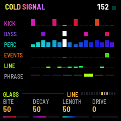

ラインは、くり返すフレーズです。16分音符で2小節、ベースの上の高いところで鳴ります。導入のあとに入り、フレーズごとに鳴るか休むかが決まります。
ほとんどいつも鳴らす世界もあれば、めったに鳴らさない世界もあります。音は世界の音階からでたらめに引かれ、その動きは LINE SEQ にあります。

- BITE（初期値: 50）: 各音の出だしの噛みつき。こもったものから明るいものへ。
- DECAY（初期値: 50）: その噛みつきが消える速さ。素早いものから、長い膨らみへ。
- LENGTH（初期値: 50）: 各音の長さ。切り詰めたものから長いものへ。
- DRIVE（初期値: 0）: 歪ませる強さ。0 できれいなまま。

ALGORITHM で種類を選びます。

| 種類 | 音 |
| --- | --- |
| ACID | 世界のまま。 |
| GLASS | やわらかく響く、打たれたガラス。 |
| GROWL | 深く揺れて歪む喉。 |
| REED | 噛みつきが落ちない、安定したブザー。 |
| BEND | 各音に5度ほど上から落ちて入る、ゴムのような音。 |
| CRUSH | 音を粗い段に砕く、壊れた機械。 |

このページで LFO を押し続けると、次の小節からフレーズが描き直されます。メッセージは `NEW PHRASE` です。

### 5.11 LINE SEQ

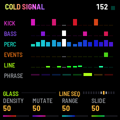

ラインのフレーズそのものです。32のステップがすべて一度に効くので、変化はすぐに聞こえます。

- DENSITY（初期値: 50）: 32ステップのうちいくつが鳴るか。裏拍に寄ります。
- MUTATE（初期値: 50）: 4小節ごとに書き換えられるステップの数。DRIFT がそれに加わります。
- RANGE（初期値: 50）: 音がどれだけ高くまで届くか。0 では根音から離れず、100 では世界の範囲の2倍まで届きます。
- SLIDE（初期値: 50）: 次の音へすべるものがどれだけあるか。

ALGORITHM で種類を選びます。LINE と同じです。LFO の長押しでフレーズを描き直せるのも同じです（`NEW PHRASE`）。

### 5.12 ATMOS

アトモスは、音楽の下に持続する和音です。各音は左右に少しずれ、さまようノイズの帯が添います。
グルーヴの下では、世界が決めた小ささで静かに鳴り、ブレイクで前に出て、ドロップのあと引っ込みます。

- COLOUR（初期値: 50）: 暗く空洞のものから、明るく開けたものへ。ビルドが上がるにつれ、ひとりでに開きます。
- AIR（初期値: 50）: さまようノイズがどれだけあるか。
- MOTION（初期値: 50）: 和音が揺れる速さ。80秒に1回ほどから、1秒に1回に近いほどまで。50 より上では、揺れが音を開いたり閉じたりもします。
- DEPTH（初期値: 50）: どれだけ大きく揺れるか。

ALGORITHM で種類を選びます。

| 種類 | 音 |
| --- | --- |
| MIST | 世界のまま。やわらかい。 |
| CHIME | 明るい、遠くの鐘。 |
| DRONE | 深く暗く、ゆっくりうなる響き。 |
| GRAIN | 和音を粒に砕く。空気が多い、森のざわめき。 |
| PULSE | 和音を音楽に合わせて16分の模様で刻む。グルーヴと一緒に息をするパッド。 |

### 5.13 MIX

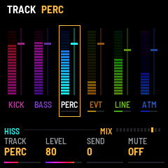

ミキサーです。6つのパートそれぞれにストリップがあります。メーターは、そのパートが鳴るにつれて点灯します。横には音量の細い溝と
つまみがあり、名前の下には、エコーへの送りを示す短い棒があります。ノブが効いているトラックには枠がつきます。ミュートしたパートは暗くなります。
ALGORITHM では、そのトラックのパートの種類を、パートのページと同じように選べます。その名前はルールの左に出ます。

- TRACK（初期値: KICK）: 次の3つのノブが効くパート。KICK、BASS、PERC、EVENTS、LINE、ATMOS（ストリップでは EVT、ATM）。
- LEVEL（初期値: KICK、BASS、PERC、EVENTS は 80、LINE と ATMOS は 70）: そのパートの音量。
- SEND（初期値: PERC は 0、EVENTS、LINE、ATMOS は 50）: そのパートがエコーへどれだけ入るか。キックとベースには送りがなく、ノブは空白です。
- MUTE（初期値: OFF）: 右に回すとそのパートをミュート、左に回すと戻ります。ECHO の黒鍵と同じです（7. パフォーマンス を参照）。

### 5.14 ECHO

各パートの送りが入るエコーと、鍵盤のパフォーマンスです。このページでは、鍵盤はイベントではなくなります。7. パフォーマンス を参照してください。

- FEEDBACK（初期値: 42）: エコーがどれだけ続くか。
- TONE（初期値: 50）: くり返しの暗さ明るさ。
- TIME（初期値: 3/16）: 1回のくり返しの長さ。音価で出ます。3/16、1/8、1/4T、3/32。
- LEVEL（初期値: 50）: エコーがどれだけ戻ってくるか。

ALGORITHM でエコーの種類を選びます。

| 種類 | くり返し |
| --- | --- |
| PING-PONG | 左右交互にくり返す。 |
| STRAIGHT | 両方のくり返しを真ん中に置く。 |
| TAPE | 揺れて暗く、少し歪む。 |
| SMEAR | くり返すたびにぼけ、リバーブに近づく。 |

### 5.15 GLOBAL

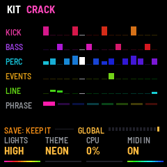

画面とボタンの設定、そして保存のページです（10. 保存 を参照）。

- LIGHTS（初期値: LOW）: ボタンの光の強さ。OFF、LOW、HIGH。
- THEME（初期値: NEON）: 画面の色と、その動き方。
- CPU: オーディオが持ち時間の何パーセントを使っているか。読み取り専用で、ノブは何もしません。たとえば `83%!` と出ていたら、音楽が
  FM-1 の処理できる限界に近づいたので、数秒のあいだ音を少し簡単にしています。

| THEME | 色と動き |
| --- | --- |
| NEON | すべての色相。 |
| ACID | 黄から緑。速く、大きく揺れ、拍ごとに衝撃があります。 |
| INFRA | 赤からマゼンタ。重く、ゆっくり。ドロップの跳びは2倍の大きさです。 |
| ICE | シアンから青。淡く静か。ゆっくり浅く、ビルドでもほとんど回りません。 |
| MONO | 白と灰色。色相なし。 |

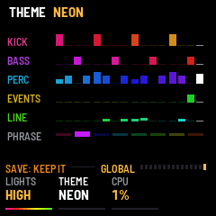
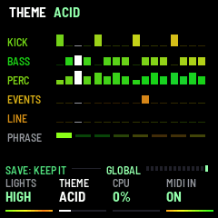

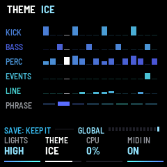
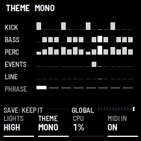

---

## 6. 鍵盤

鍵盤は音階を弾きません。押すと、音楽の中のイベントと同じ作りの一発ものの音が投げ込まれ、画面の右下にすぐ名前が出ます。
ECHO 以外のどのページでもそうです（7. パフォーマンス を参照）。

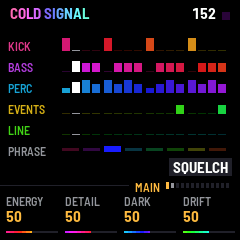

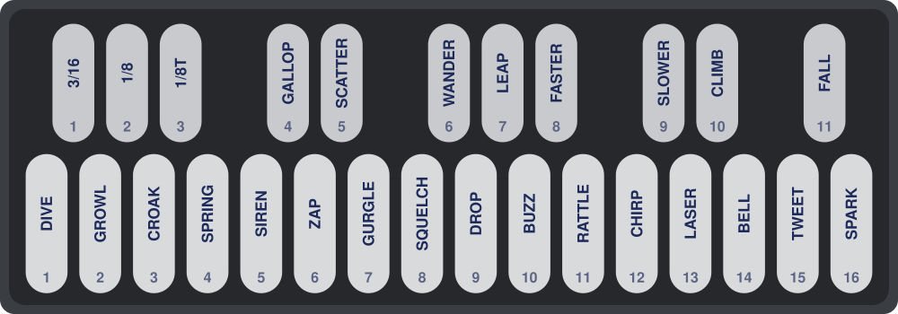

鍵には、白鍵と黒鍵それぞれ、左から番号を振っています（白鍵 1 が F3、黒鍵 1 が F#3 です）。

**白鍵。** 16あり、それぞれ別の音を持ちます（図を参照）。
音は次の16分音符で鳴り、その鍵の音程から始まります。強く押すか、強く当てるほど、噛みつきが増えます。押し続けると
16分音符ごとにくり返され、そのたびに音が少しずつ変わります。鳴るのは一度にひとつで、ほかの鍵を押すと前の音と入れ替わります。投げたものは覚えられ、ときどき音楽自身のイベントがそれを使い回します。
EVENTS ページの ALGORITHM で、すべてのイベントの種類を変えられます（5.9 を参照）。

**黒鍵。** 11あり、押し続けるとリズムになります。一緒に押している白鍵が、16分音符ごとではなく、そのリズムの拍で投げられます。
8分や3連、32分は拍の中の決まった位置に、GALLOP と SLOWER は小節の中の決まった位置に入ります。
WANDER、SCATTER、LEAP は音程が動きます。押すたびに新しい音の並びを作り、押している間は1小節ごとにそれをくり返します。
単独で押しても音は出ません。離すと16分音符に戻ります。リズムの名前は、イベントの名前の左に出ます。

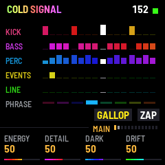

| 黒鍵 | リズム |
| --- | --- |
| 1 | 3/16: 付点8分 |
| 2 | 1/8: 8分 |
| 3 | 1/8T: 8分3連 |
| 4 | CLIMB: 16分で、毎回短3度ずつ上がる。8段 |
| 5 | FALL: 同じく、下がる |
| 6 | WANDER: 16分で、音階を上がったり下がったりする |
| 7 | SCATTER: 16分で、1オクターブの中をあちこちへ跳ぶ |
| 8 | LEAP: 8分で、根音、5度、オクターブの間を跳ぶ |
| 9 | SLOWER: 4分。拍ごとに1回 |
| 10 | FASTER: 32分。16分の倍の速さ |
| 11 | GALLOP: 拍ごとに x.xx |

**OCT− と OCT+** は、これら全体のオクターブを動かします。1つ下から2つ上まで。ヘッダーに OCTAVE と数字が出ます。

**REC。** REC を軽く押すと、次の小節を待ちます。ルールに `REC: NEXT BAR` と出て、REC がすばやく点滅します。その小節から REC が
拍ごとに点滅し、鍵盤が投げたものが、落ちたところにそのままループへ入ります。ルールには `REC: BAR 1/4` から `4/4` まで、何小節目かが
出ます。小節の頭の少し前に弾いた鍵盤は、その最初として入ります。4小節が終わると、ループはくり返し鳴り続け、REC が光ります。
取り込んでいる間に REC を押すと、その小節の終わりで取り込みが終わり、そこまでの小節数（1〜4）のループになります（メッセージに `2 BARS`
のように出て、ルールの数字も終わる小節を示します）。3小節のループは、4小節ずつのグルーヴに対して少しずつずれていきます。

もう一度 REC を軽く押すと取り直しで、次の小節から前のループが消えて新しく取り込みます。待っている間に押すとやめます（`OFF`）。
REC を長押しするとループが消えます（`CLEARED`）。PLAY で休んでも消えます。

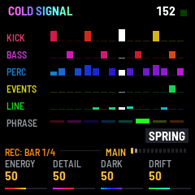

---

## 7. パフォーマンス

ECHO ページ（FX）では、鍵盤はイベントではなくパフォーマンスになります。画面には格子が出ます。

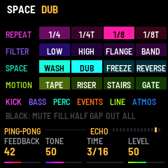

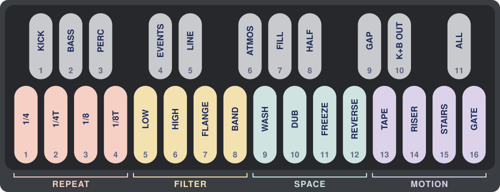

**白鍵: 16のエフェクト。** 白鍵を低いほうから順に、画面の格子を1段ずつ、4段×4つで埋めます。どれも、鍵を押している間、ミックス全体にかかり、
離すと止まります。各段のいちばん左の鍵は、段の目印として光ります。

| 白鍵 | 段 | エフェクト | 働き |
| --- | --- | --- | --- |
| 1 | REPEAT | 1/4 | 音楽の4分音符ぶんをくり返す。次の拍から。 |
| 2 | REPEAT | 1/4T | 4分3連ぶんをくり返す。次の拍から。 |
| 3 | REPEAT | 1/8 | 8分音符ぶんをくり返す。次の16分音符から。 |
| 4 | REPEAT | 1/8T | 8分3連ぶんをくり返す。次の16分音符から。 |
| 5 | FILTER | LOW | 音が暗いほうへ滑り下りる。 |
| 6 | FILTER | HIGH | 音が高いほうへ滑り上がって、細くなる。 |
| 7 | FILTER | FLANGE | 短い遅れが揺れ動く。 |
| 8 | FILTER | BAND | 電話のような細い音。 |
| 9 | SPACE | WASH | キックとベース以外が、大きなホールへ入る。くり返しはなく、雲のように包み、元の音は6割ほど沈む。離すと音楽が戻り、ホールは数秒かけて消える。 |
| 10 | SPACE | DUB | キックとベース以外がエコーへ入り、戻りが持ち上がり、元の音は3割沈む。エコーは暗く長くなり、間隔がゆっくり伸びて、テープのように揺れ、音程が沈む。離すとばねのように戻る。 |
| 11 | SPACE | FREEZE | キックとベースより上の音楽が、エコー1回ぶんだけエコーに取り込まれ、そこでループする。新たには何も入らず、元の音はその下に沈む。ECHO の LEVEL が低くても、エコーの戻りを高さのほとんどまで持ち上げ、そのあと2秒ほどかけて戻る。 |
| 12 | SPACE | REVERSE | 直前の1拍が逆再生される。 |
| 13 | MOTION | TAPE | 音楽が2拍かけて止まるまで遅くなる。 |
| 14 | MOTION | RISER | ノイズの帯が2小節かけて上がる。 |
| 15 | MOTION | STAIRS | 16分音符がくり返され、そのたびに短3度ずつ上がる。2オクターブまで。 |
| 16 | MOTION | GATE | キックとベースより上が16分音符で刻まれる。それらのエコーは続く。 |

REPEAT の4つ、REVERSE、TAPE、STAIRS は順番に入れ替わり、最後に押したものが鳴ります。それ以外は重なり、指の続く限り、いくつでも押さえられます。

**黒鍵: 11、パートの操作。** 格子の下の列にパートの名前が順に並び、その下の行に残りの名前が出ます。

| 黒鍵 | 働き |
| --- | --- |
| 1 | KICK のミュート。軽く押してミュート、もう一度で戻る。 |
| 2 | BASS のミュート。 |
| 3 | PERC のミュート。 |
| 4 | EVENTS のミュート。 |
| 5 | LINE のミュート。 |
| 6 | ATMOS のミュート。 |
| 7 | FILL: 次の拍がフィルになります。ベースが休み、クラップが駆け上がります。 |
| 8 | HALF: 押している間、ハーフタイム。キックは1拍めと3拍めに入り、ベースは8分で転がります。 |
| 9 | GAP: 小節のこれから来る最後の拍が、すべて無音になります。ドロップの前に。 |
| 10 | KICK+BASS OUT: 押している間、キックとベースが抜けます。ブレイクのように。 |
| 11 | ALL: ミュートしたパートがすべて戻ります。 |

ミュートしたパートは、画面で名前に打ち消し線がつき、その黒鍵も暗くなります。MIX の MUTE と同じものです。

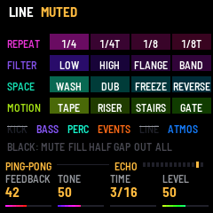

---

## 8. セクション

音楽はセクションをひとりで進み、あなたも呼べます。3つあります。グルーヴが本体です。ブレイクではキック、ベース、パーカッションが抜け、アトモスが前に出て、
イベントが薄くなり、ラインはやわらぎます。そのあとにビルドが数小節来ます。種類はいくつかあります（5.4 を参照）。そしてドロップ。小節の頭ですべてが戻り、
クラッシュが鳴ります。ドロップのあと、ベースはたいていほかの種類になり、イベントのループとラインのフレーズは描き直され、色が跳びます。
音楽はぴったり元のままには戻りません。

**ひとりで。** BREAKS が 0 より上で、DRIFT も 0 より上なら、32小節のブロックの頭でブレイクが来ることがあり、最後のドロップから GAP 小節ほど
たつまでは来ません。BREAK の LENGTH の小節数（または世界の長さ）続き、そのあとビルドとドロップがひとりでに続きます。起きやすさは BREAKS と DRIFT の
組み合わせで、初期値ではおよそ3ブロックに1回です。AUTO PLAY の間は、セットが呼びます（5.5 を参照）。5.3 を参照してください。

**呼ぶ。** どれも次の小節まで待ち、音楽が鳴っている間だけ働きます。

- SAVE: グルーヴからブレイクを呼びます。ブレイクかビルドの間は、いまどこにいるかを知らせるだけです。呼ばれている間と、ブレイクが続く間、SAVE は光ります。
  呼んだブレイクは、ビルドを呼ぶまで続きます。
- ARP を軽く押す: グルーヴかブレイクからビルドを呼びます。ビルドの間なら、次の小節でドロップ。呼びが待っている間 ARP は光り、ビルドの間は拍ごとに点滅します。
- ARP を半秒押し続ける: どこにいても、次の小節でドロップ。

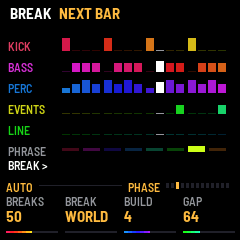

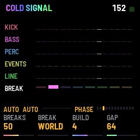

---

## 9. 世界

PRESETS で世界を選びます。どの世界も、それぞれのテンポ、根音、ベースとパーカッション、一発ものの音とライン、アトモス、ブレイクを持つ場所です。
切り替えは次の小節から。世界の名前はヘッダーにあります。ノブはどれも世界の中で効き、選んでもノブは動きません。8つあり、遅く湿ったものから速く細かいものへ並びます。

| 世界 | テンポ | 根音 | ブレイク | 特徴 |
| --- | --- | --- | --- | --- |
| SWAMP RADIO | 145 | F | 16小節 | 低くこもり、やわらかく吃るベース、湿ったクリック、厚い呟き。アトモスが大きく、ラインはめったに鳴りません。 |
| UNDER THE ROOTS | 148 | E | 24小節 | 深く長い。太く低いベース、ときどき唸り、沈む音、暗いうねり。 |
| COLD SIGNAL | 152 | F# | 16小節 | 冷たいダークサイ。硬く短い16分音符、半音で這う短いライン、レーザー、細いノイズの帯。起動したときの世界です。 |
| RUBBER CIRCUS | 156 | G | 8小節 | 弾む。ベースがときどき跳ね、しゃべるようなライン、うがい音、突然の転換。ときどき3連の小節が入り、ギャロップも多め。 |
| BLACK UNDERTOW | 160 | E | 16小節 | 重い。歪んだベース、長く引きずるライン、呻き。ブレイクが大きい。 |
| COPPER NERVE | 168 | F | 8小節 | 引き締まっている。短い金属的なくり返し、階段が始まり、8分にライド、3連の小節もわりに多め。 |
| GLASS INSECTS | 176 | F# | 8小節 | 明るいハイテック。きれいな16分音符、明るく金属的なライン、左右へ飛ぶ階段、ライド。 |
| CHROME SWARM | 186 | G | 4小節 | 速く細かい。ラインの断片とイベントにディテールがあり、いちばん密で、いつも変わり続け、ライドがあり、グルーヴの間はアトモスがほとんどありません。 |

---

## 10. 保存

GLOBAL で SAVE を軽く押すと、すべてを保存します。世界、全ページのすべてのノブ、Lights、Theme。次に FM-1 を起動したときに戻ってきます。
保存していないものがある間、GLOBAL ではルールに `SAVE: KEEP IT` と出て SAVE は光ったままで、保存が済むとヘッダーに `SAVED` と出ます（できなければ `SAVE FAILED`）。ほかのページでは SAVE はブレイクを呼ぶので
（8. セクション を参照）、保存は GLOBAL で行います。

ALGORITHM で選んだ種類や形、ミュートしたパート、オクターブ、鍵盤のループ、AUTO PLAY の ON は保存されません。音楽は毎回、世界のままの音で始まります。
新しいバージョンで保存する内容が変わると、更新後の最初の起動では、初期値に戻っていることがあります。

**初期値に戻す。** GLOBAL で SAVE を1.5秒押し続けます。全ページのすべてのノブが、最初の値に戻ります（テンポと根音は世界のまま）。世界、
Lights、Theme はそのままです。ヘッダーに `DEFAULTS` と出ます。SAVE を軽く押すまで保存はされません。

---

## 11. MIDI

MIDI 入力はいつも受けています。USB と TRS ジャックから、どのチャンネルでも受けます。DAW などがつながっていると、そこから来るクロックやスタート、
ストップにも従うので、合わせたくないときは相手の送信を止めてください。

- ノート: ノートは、対応する鍵が投げるはずの音を投げます（6. 鍵盤 を参照）。どのページでもそうで、ECHO でも、鍵盤がエフェクトを操作している間にノートは音を投げます。鍵盤は F3 から G5（MIDI ノート 53〜79）です。範囲の外のノートは、
  オクターブごと折り返して入れます。ベロシティも効き、ノートオフで押し続けた音が終わります。黒鍵のリズムも働きます。
- スタート: 頭から鳴らします。すでに鳴っていれば、頭からやり直します。
- コンティニュー: 鳴らします。
- ストップ: 休みます。
- クロック: テンポがそれに従います。125〜220 BPM の範囲で。ヘッダーには従っているテンポが出て、TEMPO ノブは脇に置かれます。
  従うのは速さだけで、拍の位置は合わせません。クロックが止まると、世界のテンポが戻ります。AUTO PLAY も、クロックがある間はそのテンポに従います。

スタート、コンティニュー、ストップは、ロゴの間の無音もすぐ終わらせます（2. 起動 を参照）。

---

## 12. USB オーディオ

USB ケーブルをつなぐと、FM-1 はコンピューターのオーディオ入力として現れます。どんな録音ソフトでも、そこから
音楽を録音できます。

---

## 13. 困ったとき

音が出ないときは、PLAY が光っているか、MASTER が上がっているかを確かめてください。ロゴが出ている間は無音です。パートがミュートされているかもしれません
（7. パフォーマンス を参照）。ブレイクの間は、しばらくキック、ベース、パーカッションが消えます（8. セクション を参照）。

色が出ないときは、GLOBAL の THEME を確かめてください。MONO には色がありません。

CPU が `%!` と出ているときは、音楽がしばらく軽くなっています（5.15 を参照）。

インストーラーが FM-1 を見つけないときは、Chrome か Edge を使い、ブラウザが尋ねたら MIDI を許可し、FM-1 の MIDI
ポートを使っているほかのプログラムを閉じてください。

M-VAVE 純正のファームウェアに戻すには、インストーラーの最後の項目で書き戻します。インストール後に FM-1 が起動
しないときは、2回起動に失敗するとセーフモードで立ち上がり、インストーラーから届きます。

---

## 14. ライセンス

RhinoTiger は GPL-3.0-only です。fm1-base（MPL-2.0）と felucca-bsp の上に作られていて、どちらも Hügelton Instruments の
Leo Kuroshita による Felucca に由来します。また、Charles Vestal による fm1-base のテンプレートから始まりました。ロゴの文字は
Noto Sans JP Black（SIL Open Font License 1.1）から描き起こしたものです。ソースは https://github.com/hacha/rhinotiger にあります。

M-VAVE と FM-1 はそれぞれの所有者の商標です。RhinoTiger は M-VAVE とは関係ありません。
