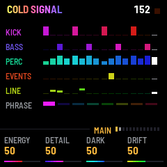
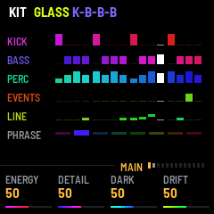
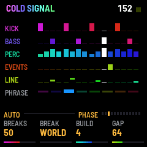
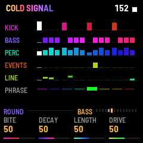
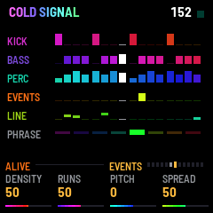
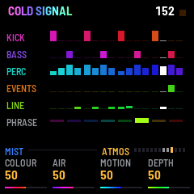
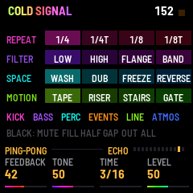
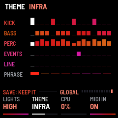
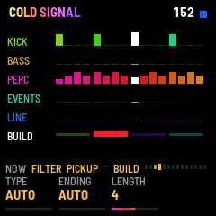

# RhinoTiger（犀虎）

[English](MANUAL.md)

RhinoTiger は、M-VAVE FM-1 のための、ダークサイからハイテックまでの自動生成サイケトランス・ファームウェアです。音楽はひとりで鳴ります。
あなたは舵を取ります。4つのマクロノブ、ミュート付きのミックス、そして音楽に一発ものの音を投げ込む鍵盤で。
キック、転がる FM ベース、パーカッション、くり返すライン、一発ものの音、持続するアトモスが、16分音符の格子の上で鳴ります。
遅く湿ったものから速く細かいものまで8つの世界があり、それぞれの振る舞いを決めます。

---

## 目次

1. インストール
2. 起動
3. 画面
4. 操作
5. ページ
6. 鍵盤
7. パフォーマンス
8. セクション
9. 世界
10. 保存
11. MIDI
12. USB オーディオ
13. 困ったとき
14. ライセンス

---

## 1. インストール

まず試すなら、エミュレーターを開いてください。同じコードがブラウザで音つきで動きます。

ブラウザからインストールするには、Chrome か Edge を使います。FM-1 を USB でつなぎ、インストーラーを開いて
Install を押します。ブラウザが MIDI の許可を一度だけ尋ねるので、許可してください。書き込み中はケーブルを
抜かないでください。

ターミナルからは、ダウンロードしたバージョンのパッケージを使って
`python3 tools/fm1_install.py rhinotiger-VERSION.fwsc` を実行します。

RhinoTiger が保存するのは自分の設定だけです。ほかのファームウェアが保存したもの（プロジェクト、プリセット、
サンプル）は読みません。そのファームウェアに戻ったときに残っているとも限らないので、先にバックアップしてください。

インストールは自己責任です。M-VAVE 純正のファームウェアに戻すには、インストーラーの最後の項目を使います。
純正のものを書き戻します。

---

## 2. 起動

FM-1 を起動すると、ロゴが出ます。背景に顔、その上に「犀」と「虎」の2文字、中ほどを横切る帯に RHINOTIGER。
ひとつずつ現れ、そろってからしばらく留まります。全部で2.4秒ほどです。ロゴが消えるまで音は出ません。消えると、
保存してある設定で、すぐに頭から音楽が始まります（10. 保存 を参照）。

待たなくてもかまいません。ロゴが出ている間に PLAY を押すと、すぐに音楽が始まります。ノブを回すことも、鍵盤を
押すことも、ロゴの間からできます。

音楽はまばらに始まります。最初の数小節で、パートがひとつずつ入ってきます。まずキック、ベース、ハット。それから
オープンハット、クラップ、ライン、残りのパート。24小節ほどたつと全部がそろいます（40秒ほど。世界によります。9. 世界 を参照）。

もう一度 PLAY を押すと、すぐに休みます。もう一度押すと、頭からまたまばらに始まります。

---

## 3. 画面

いちばん上がヘッダーです。世界の名前（9. 世界 を参照）があり、音楽が鳴っている間は色が拍ごとに右へ流れ、休んでいる間は灰色になります。
右には、1分あたりの拍数で出るテンポと、拍ごとに点滅する小さなランプ（小節の頭は白）があります。
ノブを回したりボタンを押したりした直後は、ヘッダーがしばらく、何が起きたかを知らせます。

いちばん下に4つのノブがあり、名前、値、細い棒が出ます。回したばかりのノブは明るくなります。その上に細い線（ルール）が
走り、線の上に短い帯があります。開いているページの名前と、ページごとの小さな棒の列（13本）で、開いているものが明るく光ります。
SELECT を回すとページを順に巡り、ボタンを押すとそのページへ飛べます。ルールの左には、ALGORITHM で選んだもの
（4. 操作 を参照）が名前で出ます。ほかに、REC を押している間は `REC: THE KEYS`、GLOBAL で保存していないものがあれば
`SAVE: KEEP IT` と出ます。

その間がページそのものです。ほとんどのページは同じ絵、レーンです。KICK、BASS、PERC、EVENTS、LINE の5段があり、いま
鳴っている小節を、16分音符ひとつにつき1マスで見せます。背の高い塊ほど強い打ち、点は休み、白いマスがいま鳴っている16分音符です。
ラインは音の高さで描かれます。いま開いているページのパートのレーンがいちばん明るく、ミュートしたパートは暗くなります。
レーンの下に小さな棒が8本並んでいて、これがフレーズです。8小節で1フレーズ、いま鳴っている小節が光ります。ブレイクやビルドの間は、
そのセクションの小節を数えます（8. セクション を参照）。セクションを呼んでいると、次の小節まで `BREAK >`、`BUILD >`、`DROP >` と
出ています。鍵盤から投げた一発ものの音は、右下に名前が出ます（6. 鍵盤 を参照）。

絵が違うページが2つあります。MIX はミキサーで、6本のストリップです（5.11 を参照）。ECHO は16のエフェクトと6つのパートの
格子です（7. パフォーマンス を参照）。

色は音楽につれて動きます。色相がゆっくり一緒に揺れ、ブレイクでは沈み、ビルドではだんだん速く回り、ドロップで跳びます。
パレットは GLOBAL の THEME で選びます（5.13 を参照）。

ボタンはどれも暗く光っています。開いているページのボタンは明るく、PLAY は鳴っている間、光ります。SAVE は GLOBAL では
保存していないものがあるとき、ほかのページではブレイクが呼ばれているか続いているときに光ります。ARP はビルドかドロップが
呼ばれている間光り、ビルドの間は拍ごとに点滅します。OCT− は鍵盤のオクターブが0より下のとき、OCT+ は上のときに光ります。
REC は鍵盤のループが鳴っている間光ります。光の強さは GLOBAL の Lights で決めます。

---

## 4. 操作

| 操作 | 働き |
| --- | --- |
| SELECT | 13のページを MAIN から GLOBAL まで順に巡ります。端で止まります。 |
| HOME | MAIN へ。もう一度で GROOVE。もう一度で戻ります。 |
| SEQ | PHASE へ。セクションのページです。 |
| SEL | KICK へ。もう一度で BASS。もう一度で戻ります。 |
| ENV | PERC へ。もう一度で EVENTS。もう一度で戻ります。 |
| LFO | LINE へ。もう一度で LINE SEQ、さらにもう一度で ATMOS、またもう一度で戻ります。LINE と LINE SEQ では、半秒押し続けるとページは動かず、次の小節からラインのフレーズが新しく描き直されます。 |
| EDIT | MIX へ。 |
| FX | ECHO へ。エコーと、鍵盤のパフォーマンスのページです。 |
| GLO | GLOBAL へ。 |
| PRESETS | 世界を選びます。8つ。次の小節から新しい世界になります。 |
| ALGORITHM | いま開いているページの種類を選びます（下を参照）。 |
| K1〜K4 | 開いているページの4つのノブ。0〜100 のノブは1刻みで2ずつ動きます。 |
| PLAY | 鳴らす、または休む。休んだあとは頭からやり直します。 |
| SAVE | GLOBAL では、軽く押すとすべてを保存、1.5秒押し続けると初期値に戻します（10. 保存 を参照）。ほかのページでは、ブレイクを呼びます（8. セクション を参照）。 |
| ARP | ビルド、そしてドロップを呼びます（8. セクション を参照）。 |
| REC | 押している間、鍵盤が投げたものが2小節のループに取り込まれます（6. 鍵盤 を参照）。 |
| OCT− · OCT+ | 鍵盤の音のオクターブを1つずつ動かします。1つ下から2つ上まで。OCT− は0より下、OCT+ は上にある間光ります。 |
| MASTER | 音量。 |
| 鍵盤 | 音楽に音を投げ込みます。ECHO ページでは、代わりにパフォーマンスになります。 |

ALGORITHM はページによって働きが違います。MAIN ではキットを回します。進めると、鳴っているパートのうちひとつか数個が、次の小節から
別の種類になり、一小節のうちに多く回すほど変わり、最大3パートまでです。戻すと、ひとつ前のキットへ（8回前まで）。GROOVE ではベースの形、PHASE では
ビルドの種類、ECHO ではエコーの種類を選びます。KICK、BASS、PERC、EVENTS、LINE、LINE SEQ、ATMOS では、そのパートの種類を4〜6つから選び、
新しい種類はそのパートの次の音から変わります。MIX では、TRACK で選んでいるパートの種類を選びます。GLOBAL では何もしません。選んだものの名前は、ルールの左に出ます。種類や形は
それぞれのページで紹介します。これらは保存されません（10. 保存 を参照）。

---

## 5. ページ

13あります。4つのノブはいつも開いているページのものです。各ノブについて、回すと何が聞こえるかと、最初の値を書きます。パートの音量と
エコーへの送りは、MIX にだけあります。

### 5.1 MAIN

HOME。4つのマクロです。それぞれが音楽のいくつかのことを一度に傾け、真ん中が中立です。50 なら世界のままです。

- ENERGY: にぎやかか、まばらか。上げると一発ものの音が増え、ラインが賑わい、ハットが増え、休むパートが減ります（GROOVE を参照）。
  下げると薄くなります。50。
- DETAIL: 細かいか、素朴か。上げると、一発ものの音の連打が増えて長くなり、高いところでは速くなり、ときどきハットに素早い2連打が入ります。
  下げると単発のままです。50。
- DARK: 暗く奇妙か、明るく素直か。上げるとベースが暗くなり、一発ものの音が低いほうと中ほうへ寄り、ざらつく音程が増え、ラインが半音で
  這い、高くまで届きます。下げると明るく開けます。50。
- DRIFT: 勝手にどれだけ変わるか。上げると、フレーズごとに一発ものの音がより多く描き直され、ベースがより大きく開閉し、ラインがより多く書き換えられ、
  ブレイクが勝手に来る頻度が増え、FILLS、BUILD、BREAK、GAP の長さが、ひとつ短いほうか長いほうへ外れることも増えます（8. セクション、GROOVE、PHASE を参照）。
  ドロップでベースの種類が変わることも増えます。0 ではひとりでは何も動かず、ブレイクも勝手には来ず、それらの長さはぴったりになります。50。

ALGORITHM でキットが回ります。変わったものは、ヘッダーにしばらく出て、それぞれの種類がそのパートの色で出ます。

### 5.2 GROOVE

HOME をもう一度。

- TEMPO: 速さ。1分あたりの拍数で出ます。世界のテンポから最大20、速くも遅くも動かせます。世界のまま。
- ROOT: ベースとキットの土台になる音。音名で出ます。最大で半音5つ下、6つ上へ動かせます。世界のまま。
- FILLS: 小節の最後の拍がフィルになる頻度（ベースが休み、クラップが駆け上がります）と、フレーズの終わりにキックがひねりを入れる頻度。
  OFF、または32、16、8、4小節ごと。これはふだんの間隔で、32小節ごとに、しばらくその半分や倍になることがあります。DRIFT が高いほど多く。
  それでもフィルは、4、8、16、32小節の区切りの終わりに入ります。8。
- SIT OUT: パーカッション（ハット、オープンハット、クラップ、ライド）のどれかが、フレーズひとつぶん休む頻度。0 なら休みません。25。

ALGORITHM でベースの形を選びます。AUTO は世界に任せます。拍ごとにキック、そのあとの3つの16分音符でベースが転がり、ときどきギャロップ、裏拍、
3連の小節が入ります（3連は入る世界だけ）。K-B-B-B は転がりのまま、GALLOP はギャロップのまま、OFFBEAT は裏拍のままにします。新しい形は次の
小節から始まります。

### 5.3 PHASE

SEQ。ブレイク、ビルド、ドロップを、音楽がひとりでどう進むか。自分で呼ぶには SAVE と ARP を押します（8. セクション を参照）。

- BREAKS: ブレイクが勝手に来る頻度。0 では CUED と出て、呼んだときしか来ません。上げるほど頻繁で、DRIFT の影響も受けます。50。
- BREAK: 勝手に来たブレイクのふだんの長さ。WORLD は世界に任せ、または 4、8、16、32小節。ときどき、その半分か倍の長さになります。DRIFT が高いほど多く。WORLD。
- BUILD: ふだんのビルドの長さ。2、4、8小節。ときどき、ひとつ短いか長いビルドになります。DRIFT が高いほど多く。4。
- GAP: ドロップから、次の勝手なブレイクまでの最短の小節数。32、64、96、128。ドロップによっては、ひとつ短いか長くなります。DRIFT が高いほど多く。64。

ALGORITHM でビルドの種類を選びます。AUTO は、世界の好みに沿って毎回ほかのどれかを選びます。続けて同じものにはなりません。ビルドの間は、選ばれたものも
ルールに出ます。

- ROLL: キットとベースが抜け、クラップが4分、8分、16分と転がります。
- KICK: キックが同じように転がり、1オクターブ上がります。ベースは抜けます。
- FILTER: キックは残り、パーカッションは2つめの4分から、ベースは半ばから入り、ベースは下を削られ、ハットは強くなります。
- TRIPLET: クラップが4分、8分3連、16分3連と上がるように転がります。
- STUTTER: グルーヴが続いたまま、だんだん小さな切れ端で繰り返されます。4分、8分、16分、32分。
- POLY: キックが小節に対して付点8分、やがて付点16分、そして16分へと詰まり、クラップは2拍めと4拍めに入ります。
- SINK: 逆向き。クラップが16分、8分、4分と遅く落ちていくように転がり、ほかは上から閉じていきます。
- FAKE: ROLL のあと、1拍だけのドロップが入って途中で切れ、1小節ぶんのクラップの16分があって、本物のドロップが来ます。

どのビルドにもライザーがつき、最後の拍は無音です。

### 5.4 KICK

SEL。

- TUNE: キックの音程。半音6つまで下にも上にも。0 より上は + 付きで出ます。0。
- DRIVE: 歪ませる強さ。やわらかくきれいなものから荒いものへ。50。
- PUNCH: 出だしのクリックの鋭さ。50。
- DECAY: 胴の長さ。短く締まったものから、長く満ちたものへ。ベースの最初の音にはぶつかりません。50。

ALGORITHM で種類を選びます。SOLID は世界のまま、HARD は落ち方が速くクリックが大きく歪みも多い、KNOCK は短く、ブーンの下に木が鳴る、ZIP は高いところから
ゆっくり落ちる、暗いキックのジッ、CRACK は速く落ちて締まり、上に明るいノイズがはじける、ハイテックのキックの破裂音。

### 5.5 BASS

SEL をもう一度。

- BITE: 各音の出だしの噛みつき。丸いものから唸るものへ。50。
- DECAY: その噛みつきがどれだけ続くか。下げると丸く、上げると音の間ずっと唸りが残ります。50。
- LENGTH: 各音の長さ。短く弾ける音（世界の4分の1）から、音として許される限りの長さまで。50。
- DRIVE: ベースを歪ませる強さ。50。

ALGORITHM で種類（ベースの色）を選びます。ROUND、BITTEN、METAL、HOLLOW、SNAP（各音の頭に硬いクリック、その下は丸い）、NASAL（中の空いた、鼻にかかったブザー）。たいていのドロップで、ひとりでほかのものに変わります。DRIFT が低いほど、同じまま続くことが増えます。

### 5.6 PERC

ENV。

- HATS: 閉じたハットの音量と、弱い16分音符のどれだけが鳴るか。0 ではハットもオープンハットもありません。50。
- OPEN: オープンハットの響く長さ。世界の4分の1から4倍まで。50。
- CLAP: 2拍めと4拍めのクラップの音量。0 でなし。50。
- TONE: 50 より下ではパーカッション全体が暗くなり、0 でこもります。50 より上ではハットが細くなり、クラップの帯が上がります。50 はそのまま。

ALGORITHM で種類を選びます。HISS は世界のまま、TIN は長く響く小さな安物のシンバル、TICK は短く細い乾いたチック、GRIT は階段状に
粗くしたノイズで、機械のなかの埃、SEED は低めの狭い帯のノイズがゆっくりふくらみ、まばらな粒でパラパラ鳴る、シェイカーの種です。

### 5.7 EVENTS

ENV をもう一度。イベントは、ダークサイやハイテックを形づくる一発ものの音です。ザップ、うがい音、ダイブ、唸り、さえずり、レーザーが、単発か、連なり（音程の
階段、ロール）で鳴ります。音楽は、裏拍に4小節ぶんのイベントをループとして持ち、フレーズごとにいくつかが変わります。鍵盤から
投げたものも、そこに加わります（6. 鍵盤 を参照）。

- DENSITY: どれだけ多いか。50。
- RUNS: そのうち、単発でなく連なりになるものがどれだけか。50。
- PITCH: すべての音程。1オクターブまで下にも上にも。0。
- SPREAD: ステレオでの広がり。0 ですべて真ん中、50 でそれぞれ作られたとおり、100 に向かうと大きく左右へ散り、ひとつひとつが片側からもう片側へ横切ります。50。

ALGORITHM で種類を選びます。ALIVE はそのまま、METAL は打たれた板や針金、LIQUID は水の中の音でゆっくり深く揺れ、SHARD は短く荒く、割れたガラスか機械の故障、GHOST は逆回しで、無からふくらみ、いちばん大きいところで切れる、吸い込まれる音、RATCHET は1秒に20〜30回途切れながら長く鳴る、機械の歯です。

### 5.8 LINE

LFO。ラインは、くり返すフレーズです。16分音符で2小節、ベースの上の高いところで鳴ります。導入のあとに入り、フレーズごとに鳴るか休むかが決まります。
ほとんどいつも鳴らす世界もあれば、めったに鳴らさない世界もあります。音は世界の音階からでたらめに引かれ、その動きは LINE SEQ にあります。

- BITE: 各音の出だしの噛みつき。こもったものから明るいものへ。50。
- DECAY: その噛みつきが消える速さ。素早いものから、長い膨らみへ。50。
- LENGTH: 各音の長さ。切り詰めたものから長いものへ。50。
- DRIVE: 歪ませる強さ。0 できれいなまま。0。

ALGORITHM で種類を選びます。ACID は世界のまま、GLASS はやわらかく響く打たれたガラス、GROWL は深く揺れて歪む喉、REED は噛みつきが落ちない、安定したブザー、BEND は各音に5度ほど上から落ちて入る、ゴムのような音、CRUSH は音を粗い段に砕く、壊れた機械です。

このページで LFO を押し続けると、次の小節からフレーズが描き直されます。メッセージは `NEW PHRASE` です。

### 5.9 LINE SEQ

LFO をもう一度。フレーズそのものです。32のステップがすべて一度に効くので、変化はすぐに聞こえます。

- DENSITY: 32ステップのうちいくつが鳴るか。裏拍に寄ります。50。
- MUTATE: 4小節ごとに書き換えられるステップの数。DRIFT がそれに加わります。50。
- RANGE: 音がどれだけ高くまで届くか。0 では根音から離れず、100 では世界の範囲の2倍まで届きます。50。
- SLIDE: 次の音へすべるものがどれだけあるか。50。

ALGORITHM で種類を選びます。LINE と同じです。

### 5.10 ATMOS

LFO をさらにもう一度。アトモスです。音楽の下に持続する和音があり、各音は左右に少しずれ、さまようノイズの帯が添います。
グルーヴの下では、世界が決めた小ささで静かに鳴り、ブレイクで前に出て、ドロップのあと引っ込みます。

- COLOUR: 暗く空洞のものから、明るく開けたものへ。ビルドが上がるにつれ、ひとりでに開きます。50。
- AIR: さまようノイズがどれだけあるか。50。
- MOTION: 和音が揺れる速さ。80秒に1回ほどから、1秒に1回に近いほどまで。50 より上では、揺れが音を開いたり閉じたりもします。50。
- DEPTH: どれだけ大きく揺れるか。50。

ALGORITHM で種類を選びます。MIST は世界のまま、やわらかい、CHIME は明るく、遠くの鐘、DRONE は深く暗く、ゆっくりうなる響き、GRAIN は和音を粒に砕き、空気が多く、森のざわめき、PULSE は和音を音楽に合わせて16分の模様で刻む、グルーヴと一緒に息をするパッドです。

### 5.11 MIX

EDIT。6つのパートそれぞれにストリップがあります。メーターは、そのパートが鳴るにつれて点灯します。横には音量の細い溝と
つまみがあり、名前の下には、エコーへの送りを示す短い棒があります。ノブが効いているトラックには枠がつきます。ミュートしたパートは暗くなります。
ALGORITHM では、そのトラックのパートの種類を、パートのページと同じように選べます。その名前はルールの左に出ます。

- TRACK: 次の3つのノブが効くパート。KICK、BASS、PERC、EVENTS、LINE、ATMOS。KICK。
- LEVEL: そのパートの音量。キック、ベース、パーカッション、イベントは 80、ラインとアトモスは 70。
- SEND: そのパートがエコーへどれだけ入るか。キックとベースには送りがなく、ノブは空白です。パーカッションは 0、イベントとラインとアトモスは 50。
- MUTE: 右に回すとそのパートをミュート、左に回すと戻ります。OFF。ECHO の黒鍵と同じです（7. パフォーマンス を参照）。

### 5.12 ECHO

FX。各パートの送りが入るエコーと、鍵盤のパフォーマンスです。このページでは、鍵盤はイベントではなくなります。7. パフォーマンス を参照してください。

- FEEDBACK: エコーがどれだけ続くか。42。
- TONE: くり返しの暗さ明るさ。50。
- TIME: 1回のくり返しの長さ。音価で出ます。3/16、1/8、1/4T、3/32。3/16。
- LEVEL: エコーがどれだけ戻ってくるか。50。

ALGORITHM でエコーの種類を選びます。切り替わりは少しずつです。PING-PONG は左右交互にくり返し、STRAIGHT は両方のくり返しを真ん中に置き、TAPE は揺れて暗く、少し歪み、
SMEAR はくり返すたびにぼけ、リバーブに近づきます。

### 5.13 GLOBAL

GLO。

- LIGHTS: ボタンの光の強さ。OFF、LOW、HIGH。LOW。
- THEME: 画面の色と、その動き方。NEON。
- CPU: オーディオが持ち時間の何パーセントを使っているか。読み取り専用で、ノブは何もしません。たとえば `83%!` と出ていたら、音楽が
  FM-1 の処理できる限界に近づいたので、軽くなっています。アトモスは3音でなく1音になり、イベントは声が半分になり、FLANGE は切れます。
  最後にそうなってから8秒ほど、軽いままです。
- MIDI IN: ON か OFF。OFF。右に回すと ON（11. MIDI を参照）。

テーマ:

- NEON: すべての色相。
- ACID: 黄から緑。速く、大きく揺れ、拍ごとに衝撃があります。
- INFRA: 赤からマゼンタ。重く、ゆっくり。ドロップの跳びは2倍の大きさです。
- ICE: シアンから青。淡く静か。ゆっくり浅く、ビルドでもほとんど回りません。
- MONO: 白と灰色。色相なし。

---

## 6. 鍵盤

鍵盤は音階を弾きません。押すと、音楽の中のイベントと同じ作りの一発ものの音が投げ込まれ、画面の右下にすぐ名前が出ます。
ECHO 以外のどのページでもそうです（7. パフォーマンス を参照）。

**白鍵。** 16あり、F3 から G5 まで。それぞれ別の音を持ち、低いほうから:

| 鍵 | 音 | 鍵 | 音 |
| --- | --- | --- | --- |
| F3 | DIVE | F4 | SQUELCH |
| G3 | GROWL | G4 | DROP |
| A3 | CROAK | A4 | BUZZ |
| B3 | SPRING | B4 | RATTLE |
| C4 | SIREN | C5 | CHIRP |
| D4 | ZAP | D5 | LASER |
| E4 | GURGLE | E5 | BELL |

F5 は TWEET、G5 は SPARK です。

音は次の16分音符で鳴るので、グルーヴから外れません。音は、その鍵の音程から始まります。強く押すか、強く当てるほど、噛みつきが増えます。押し続けると
16分音符ごとにくり返され、そのたびに音が少しずつ変わります。投げたものは覚えられ、ときどき音楽自身のイベントがそれを使い回します。
EVENTS ページの ALGORITHM で、すべてのイベントの種類を変えられます（5.7 を参照）。

**黒鍵。** 11あり、F#3 から F#5 まで。押し続けるとリズムになります。一緒に押している白鍵が、16分音符ごとではなく、そのリズムの拍で投げられます。
単独で押しても音は出ません。離すと16分音符に戻ります。リズムの名前は、イベントの名前の左に出ます。

| 鍵 | リズム |
| --- | --- |
| F#3 | 3/16: 付点8分 |
| G#3 | 1/8: 8分 |
| A#3 | 1/8T: 8分3連 |
| C#4 | GALLOP |
| D#4 | OFFBEAT: 裏の8分 |
| F#4 | 1/16T: 16分3連 |
| G#4 | 3-3-2: 2拍にわたって |
| A#4 | FASTER: 2拍かけてだんだん速く |
| C#5 | SLOWER: 2拍かけてだんだん遅く |
| D#5 | CLIMB: 16分で、毎回短3度ずつ上がる。8段 |
| F#5 | FALL: 同じく、下がる |

**OCT− と OCT+** は、これら全体のオクターブを動かします。1つ下から2つ上まで。ヘッダーに OCTAVE と数字が出ます。

**REC。** REC を押している間、ルールに `REC: THE KEYS` と出ます。鍵盤が投げたものは、落ちたところにそのまま、2小節のループへ入ります。離すと、そのまま
くり返し鳴り続け、メッセージは `LOOPING` です。ループが鳴っている間、REC は光ります。もう一度 REC を押すと新しく取り直しになり、前のものは消えます。何も弾かずに
REC を軽く押すと、ループが消えます（`CLEARED`）。PLAY で休んでも消えます。

---

## 7. パフォーマンス

ECHO ページ（FX）では、鍵盤はイベントではなくパフォーマンスになります。画面には格子が出ます。

**白鍵: 16のエフェクト。** 白鍵を低いほうから順に、画面の格子を1段ずつ、4段×4つで埋めます。どれも、鍵を押している間、ミックス全体にかかり、
離すと止まります。各段のいちばん左の鍵は、段の目印として光ります。どれも数ミリ秒でフェードイン・アウトします。

*REPEAT。* 音楽、またはそのいま鳴った断片を、くり返し続けます。
- 1/4: 音楽の4分音符ぶんをくり返す。次の拍から。
- 1/4T: その4分3連ぶん。次の拍から。
- 1/8: 8分音符ぶん。次の16分音符から。
- 1/8T: 8分3連ぶん。次の16分音符から。

*FILTER。*
- LOW: 音が暗いほうへ滑り下りる。
- HIGH: 音が高いほうへ滑り上がって、細くなる。
- FLANGE: 短い遅れが揺れ動く。
- BAND: 電話のような細い音。

*SPACE。*
- WASH: キックとベース以外が、大きなホールへ入ります。くり返しはなく、雲のように包み、元の音は6割ほど沈みます。離すと音楽が戻り、ホールは数秒かけて消えます。
- DUB: キックとベース以外がエコーへ入り、戻りが持ち上がり、元の音は3割沈みます。エコーは暗く長くなり、間隔がゆっくり伸びて、テープのように揺れ、音程が沈みます。離すとばねのように戻ります。
- FREEZE: キックとベースより上の音楽が、エコー1回ぶんだけエコーに取り込まれ、そこでループします。新たには何も入らず、元の音はその下に沈みます。ECHO の LEVEL が
  低くても、エコーの戻りを高さのほとんどまで持ち上げ、そのあと2秒ほどかけて戻ります。
- REVERSE: 直前の1拍が逆再生されます。

*MOTION。*
- TAPE: 音楽が2拍かけて止まるまで遅くなります。
- RISER: ノイズの帯が2小節かけて上がります。
- STAIRS: 16分音符がくり返され、そのたびに短3度ずつ上がり、2オクターブまで。
- GATE: キックとベースより上が16分音符で刻まれます。それらのエコーは続きます。

くり返し系、REVERSE、TAPE、STAIRS は順番に入れ替わり、最後に押したものが鳴ります。それ以外は重なり、指の続く限り、いくつでも押さえられます。

**黒鍵: 11、パートの操作。** 格子の下の列にパートの名前が順に並び、その下の行に残りの名前が出ます。

| 鍵 | 働き |
| --- | --- |
| F#3 | KICK のミュート。軽く押してミュート、もう一度で戻る。 |
| G#3 | BASS のミュート。 |
| A#3 | PERC のミュート。 |
| C#4 | EVENTS のミュート。 |
| D#4 | LINE のミュート。 |
| F#4 | ATMOS のミュート。 |
| G#4 | FILL: 次の拍がフィルになります。ベースが休み、クラップが駆け上がります。 |
| A#4 | HALF: 押している間、ハーフタイム。キックは1拍めと3拍めに入り、ベースは8分で転がります。 |
| C#5 | GAP: 小節のこれから来る最後の拍が、すべて無音になります。ドロップの前に。 |
| D#5 | KICK+BASS OUT: 押している間、キックとベースが抜けます。ブレイクのように。 |
| F#5 | ALL: ミュートしたパートがすべて戻ります。 |

ミュートしたパートは、画面で名前に打ち消し線がつき、その黒鍵も暗くなります。MIX の MUTE と同じものです。

---

## 8. セクション

音楽はセクションをひとりで進み、あなたも呼べます。3つあります。グルーヴが本体です。ブレイクではキック、ベース、パーカッションが抜け、アトモスが前に出て、
イベントが薄くなり、ラインはやわらぎます。そのあとにビルドが数小節来て、ロールと上がっていくノイズが入ります。そしてドロップ。小節の頭ですべてが戻り、
クラッシュが鳴ります。ドロップのあと、ベースはたいていほかの種類になり、イベントのループとラインのフレーズは描き直され、色が跳びます。
音楽はぴったり元のままには戻りません。

**ひとりで。** BREAKS が 0 より上で、DRIFT も 0 より上なら、32小節のブロックの頭でブレイクが来ることがあり、最後のドロップから GAP 小節ほど
たつまでは来ません。BREAK 小節（または世界の長さ）続き、そのあとビルドとドロップがひとりでに続きます。起きやすさは BREAKS と DRIFT の
組み合わせで、初期値ではおよそ3ブロックに1回です。PHASE（5.3）を参照してください。

**呼ぶ。** どれも次の小節まで待ち、音楽が鳴っている間だけ働きます。

- SAVE: グルーヴからブレイクを呼びます。ブレイクかビルドの間は、いまどこにいるかを知らせるだけです。呼ばれている間と、ブレイクが続く間、SAVE は光ります。
  呼んだブレイクは、ビルドを呼ぶまで続きます。
- ARP を軽く押す: グルーヴかブレイクからビルドを呼びます。ビルドの間なら、次の小節でドロップ。呼びが待っている間 ARP は光り、ビルドの間は拍ごとに点滅します。
- ARP を半秒押し続ける: どこにいても、次の小節でドロップ。

---

## 9. 世界

PRESETS で世界を選びます。どの世界も、それぞれのテンポ、根音、ベースとパーカッション、一発ものの音とライン、アトモス、ブレイクを持つ場所です。
切り替えは次の小節から。世界の名前はヘッダーにあります。ノブはどれも世界の中で効き、選んでもノブは動きません。8つあり、遅く湿ったものから速く細かいものへ並びます。

- SWAMP RADIO: 145、根音 F。低くこもり、やわらかく吃るベース、湿ったクリック、厚い呟き。アトモスが大きく、ラインはめったに鳴りません。ブレイクは16小節。
- UNDER THE ROOTS: 148、根音 E。深く長い。太く低いベース、ときどき唸り、沈む音、暗いうねり。長いブレイクで24小節。
- COLD SIGNAL: 152、根音 F#。冷たいダークサイ。硬く短い16分音符、半音で這う短いライン、レーザー、細いノイズの帯。ブレイクは16小節。起動したときの世界です。
- RUBBER CIRCUS: 156、根音 G。弾む。ベースがときどき跳ね、しゃべるようなライン、うがい音、突然の転換。ときどき3連の小節が入り、ギャロップも多め。ブレイクは8小節。
- BLACK UNDERTOW: 160、根音 E。重い。歪んだベース、長く引きずるライン、呻き。大きいブレイクで16小節。
- COPPER NERVE: 168、根音 F。引き締まっている。短い金属的なくり返し、階段が始まり、8分にライド、3連の小節もわりに多め。ブレイクは8小節。
- GLASS INSECTS: 176、根音 F#。明るいハイテック。きれいな16分音符、明るく金属的なリード、左右へ飛ぶ階段、ライド。短いブレイクで8小節。
- CHROME SWARM: 186、根音 G。速く細かい。ラインの断片とイベントにディテールがあり、いちばん密で、いつも変わり続け、ライドがあり、グルーヴの間はアトモスがほとんどありません。ブレイクはわずか4小節。

---

## 10. 保存

GLOBAL で SAVE を軽く押すと、すべてを保存します。世界、全ページのすべてのノブ、Lights、Theme、MIDI IN。次に FM-1 を起動したときに戻ってきます。
保存していないものがある間、ルールに `SAVE: KEEP IT` と出て SAVE は光ったままで、保存が済むとヘッダーに `SAVED` と出ます。ほかのページでは SAVE はブレイクを呼ぶので
（8. セクション を参照）、保存は GLOBAL で行います。

ALGORITHM で選んだ種類や形、ミュートしたパート、オクターブ、鍵盤のループは保存されません。音楽は毎回、世界のままの音で始まります。
新しいバージョンで保存する内容が変わると、更新後の最初の起動では、初期値に戻っていることがあります。

**初期値に戻す。** GLOBAL で SAVE を1.5秒押し続けます。全ページのすべてのノブが、最初の値に戻ります（テンポと根音は世界のまま）。世界、
Lights、Theme、MIDI IN はそのままです。ヘッダーに `DEFAULTS` と出ます。SAVE を軽く押すまで保存はされません。

---

## 11. MIDI

MIDI 入力は任意で、GLOBAL の MIDI IN を ON にすると働きます。ON にするまでは OFF です。USB と TRS ジャックから、どのチャンネルでも受けます。

- ノート: ノートは、対応する鍵が投げるはずの音を投げます（6. 鍵盤 を参照）。鍵盤は F3 から G5（MIDI ノート 53〜79）です。範囲の外のノートは、
  オクターブごと折り返して入れます。ベロシティも効き、ノートオフで押し続けた音が終わります。黒鍵のリズムも働きます。
- スタート: 頭から鳴らします。すでに鳴っていれば、頭からやり直します。
- コンティニュー: 鳴らします。
- ストップ: 休みます。
- クロック: テンポがそれに従います。1拍あたり24パルス、125〜220 BPM の範囲で。ヘッダーには従っているテンポが出て、TEMPO ノブは脇に置かれます。
  従うのは速さだけで、拍の位置は合わせません。クロックが半秒来なくなると、世界のテンポが戻ります。効き始めるまでに24パルスが要ります。

スタート、コンティニュー、ストップは、ロゴの間の無音もすぐ終わらせます（2. 起動 を参照）。

---

## 12. USB オーディオ

USB ケーブルをつなぐと、FM-1 はコンピューターのオーディオ入力として現れます。どんな録音ソフトでも、そこから
音楽を録音できます。

---

## 13. 困ったとき

音が出ないときは、PLAY が光っているか、MASTER が上がっているかを確かめてください。ロゴが出ている間は無音です。パートがミュートされているかもしれません
（7. パフォーマンス を参照）。ブレイクの間は、しばらくキック、ベース、パーカッションが消えます（8. セクション を参照）。

色が出ないときは、GLOBAL の THEME を確かめてください。MONO には色がありません。

CPU が `%!` と出ているときは、音楽がしばらく軽くなっています（5.13 を参照）。

インストーラーが FM-1 を見つけないときは、Chrome か Edge を使い、ブラウザが尋ねたら MIDI を許可し、FM-1 の MIDI
ポートを使っているほかのプログラムを閉じてください。

M-VAVE 純正のファームウェアに戻すには、インストーラーの最後の項目で書き戻します。インストール後に FM-1 が起動
しないときは、2回起動に失敗するとセーフモードで立ち上がり、インストーラーから届きます。

---

## 14. ライセンス

RhinoTiger は GPL-3.0-only です。fm1-base（MPL-2.0）と felucca-bsp の上に作られていて、どちらも Hügelton Instruments の
Leo Kuroshita による Felucca に由来します。また、Charles Vestal による fm1-base のテンプレートから始まりました。ロゴの文字は
Noto Sans JP Black（SIL Open Font License 1.1）から描き起こしたものです。ソースは https://github.com/hacha/rhinotiger にあります。

M-VAVE と FM-1 はそれぞれの所有者の商標です。RhinoTiger は M-VAVE とは関係ありません。
