# RhinoTiger

[日本語](MANUAL.ja.md)

RhinoTiger is a generative psytrance firmware for the M-VAVE FM-1, from dark psy to hi-tech. It plays by itself. You
steer it: four macro knobs, a mix with mutes, and a keyboard that throws one-shot sounds into the music. A kick, a
rolling FM bass, percussion, a repeating line, one-shot sounds and a held atmosphere play on a grid of sixteenths.
Eight worlds, slow and wet to fast and fine, decide how it all behaves.

---

## Contents

1. Install
2. Starting up
3. The screen
4. Controls
5. The pages
6. The keys
7. The performance
8. Sections
9. Worlds
10. Saving
11. MIDI
12. USB audio
13. Troubleshooting
14. Licence

---

## 1. Install

To try it first, open the [emulator](../emu/). It runs the same code in your browser, with sound.

To install it from the browser, use Chrome or Edge. Connect the FM-1 by USB, open the [installer](../install/) and press Install.
The browser asks once to allow MIDI, so allow it. Don't unplug the cable while it writes.

To install it from a terminal, download the package and, in the source, run
`python3 base/tools/fm1_install.py rhinotiger-VERSION.fwsc`.

RhinoTiger keeps only its own settings. It doesn't read what another firmware saved (projects, presets, samples),
and that may not be there when you go back to it, so back it up first.

You install it at your own risk. To go back to the stock firmware, use the installer's "Back to the stock firmware":
download M-VAVE's own firmware (FM-1.fwsc), choose it there and press the button.

---

## 2. Starting up

Switch the FM-1 on and the logo shows. When it goes, the music starts by itself, with the settings you saved (see 10.
Saving).

To start without waiting, press PLAY while the logo is up.

The music starts sparse, and the parts come in one by one until it is all there.

PLAY rests it. Press it again and it begins anew, sparse as before.

---

## 3. The screen

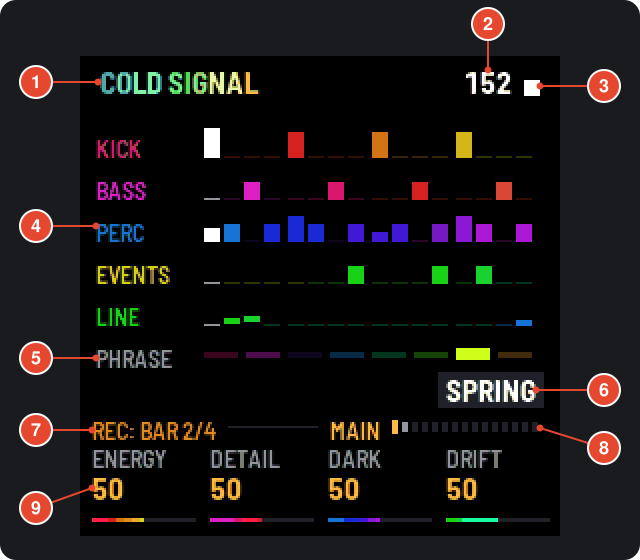

1. **The world's name** (see 9. Worlds). Its colours flow to the right with each beat while the music plays, and turn grey while it rests. For a moment after you do something (turn a knob, press a button), it says what happened instead.
2. **The tempo**, in beats per minute.
3. **The beat lamp.** It blinks on the beat, and is white on the first beat of a bar.
4. **The lanes.** Five rows, KICK, BASS, PERC, EVENTS and LINE. Each shows the bar that is playing, one cell for every sixteenth: a taller block is a harder hit, a dot is a rest, and a white cell marks the sixteenth sounding now. The line draws its notes by height. The lane of the part whose page you are on is brightest; a muted part is dark.
5. **The phrase.** Eight small bars, one for each bar of the phrase; the one playing is lit. In a break or a build it counts that section's bars instead (see 8. Sections), and when a section is cued, `BREAK >`, `BUILD >` or `DROP >` waits there until the next bar.
6. **The sound thrown.** The name of the one-shot sound you threw from the keys (see 6. The keys).
7. **The left of the rule.** The name of what ALGORITHM has picked (see 4. Controls). Also what needs saying: `REC: NEXT BAR` while REC waits and `REC: BAR 1/4` while it takes (see 6. The keys), the minutes gone while AUTO PLAY is on (see 5.5), and `SAVE: KEEP IT` on GLOBAL when something is not saved.
8. **The page.** The name of the page you are on, and a row of 15 small bars, one for each page, with the shown one lit.
9. **The knobs.** The name, the value and a thin bar for each of K1 to K4. A knob you have just turned lights up.

Two pages have a picture of their own instead of the lanes. On MIX it is the mixer, six strips (see 5.13). On ECHO it is the grid of sixteen effects and the six parts (see 7. The performance).

The colours move with the music. The hues sway slowly together, sink in a break, spin faster and faster through a
build and jump at the drop. THEME, on the global page, chooses the palette (see 5.15).

Every button glows dim, and the button of the page you are on glows bright. The others light up when they have something to say. LIGHTS, on the global page, sets how bright the glow is (see 5.15).

| Button | When it lights |
| --- | --- |
| PLAY | While it plays. |
| SAVE | While a break is cued or on. On GLOBAL, while something is not saved. |
| ARP | While a build or a drop is cued. It flashes on the beats during a build. |
| REC | Blinks quickly while it waits for the next bar, on the beats while it takes, and is lit while the keys' loop plays. |
| OCT− | While the keys' octave is below 0. |
| OCT+ | While the keys' octave is above 0. |

---

## 4. Controls

### Opening a page

**Turn SELECT (2) and it goes through the 15 pages in order, from MAIN to GLOBAL.** Every page can be reached this way. It stops at the ends.

**The coloured buttons (8) are shortcuts to the pages.** Press one to jump to its page. Press it again to step through that button's pages.

| Button | Pages |
| --- | --- |
| HOME | MAIN, GROOVE |
| SEQ | BREAK, BUILD, AUTO |
| SEL | KICK, BASS |
| ENV | PERC, EVENTS |
| LFO | LINE, LINE SEQ, ATMOS |
| EDIT | MIX |
| FX | ECHO |
| GLO | GLOBAL |

Only LFO does one more thing. On LINE and LINE SEQ, hold it for half a second and the page stays, and the line's phrase is drawn anew from the next bar (see 5.10).

### The other controls

| Number | Control | What it does |
| --- | --- | --- |
| 1 | MASTER | The volume. |
| 3 | PRESETS | Picks the world (see 9. Worlds). Eight worlds, and it goes round at the ends. The new one begins from the next bar. |
| 4 | ALGORITHM | Picks a type, for the page you are on (see below). |
| 5 | OCT− · OCT+ | Move the octave of the keys' sounds, one octave at a time, from one down to two up (see 6. The keys). |
| 7 | K1 to K4 | The four knobs of the page that is shown. Knobs with a wide range (0 to 100, and FEEDBACK) move one at a step when turned slowly, two at a step when turned faster, and four when faster still. |
| 9 | SAVE | Calls a break (see 8. Sections). On GLOBAL only, it is the save button: tap to keep everything, hold for 1.5 seconds for the defaults (see 10. Saving). |
| 10 | ARP | Calls a build, then the drop (see 8. Sections). |
| 11 | PLAY | Plays, or rests. After a rest it begins again from the top. |
| 12 | REC | Tap it and, from the next bar, what the keys throw is taken into a loop of up to four bars. Tap while it takes to end it there. Hold it and the loop is gone (see 6. The keys). |
| 13 | Black keys | While held, the white keys throw on their rhythm (see 6. The keys). On the ECHO page they work the parts instead (see 7. The performance). |
| 14 | White keys | Throw one-shot sounds into the music (see 6. The keys). On the ECHO page they are the effects instead (see 7. The performance). |

ALGORITHM does something different on each page. The name of the choice shows at the left of the rule. The types and shapes are listed on the pages they belong to.
They are not saved (see 10. Saving).

| Page | What ALGORITHM picks |
| --- | --- |
| MAIN | Turns the kit. Turn it forward and one or a few of the sounding parts take another type from the next bar; the more you turn within a bar, the more parts change, up to three. Turn it back for the kit before, up to eight steps. |
| GROOVE | The shape of the bass. |
| KICK, BASS, PERC, EVENTS, LINE, LINE SEQ, ATMOS | The type of that part, one of five or six. The new type begins from the part's next note. |
| MIX | The type of the track TRACK has chosen. |
| ECHO | The kind of echo. |
| BREAK, BUILD, AUTO, GLOBAL | Nothing. |

---

## 5. The pages

There are 15. The four knobs always belong to the page you are on. Each knob is listed with what you hear as it turns.
The default is in brackets. A part's level and its send into the echo are on MIX only (see 5.13).

### 5.1 MAIN

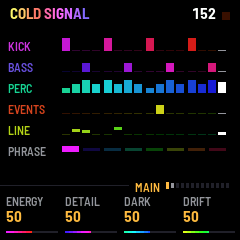

Four macros. Each leans several things in the music at once, and each is neutral in the middle: at 50 the
world is as it is.

- ENERGY (default 50): busier or sparser. Higher brings more one-shot sounds, a livelier line and more hats, and fewer parts sitting out (see
  GROOVE). Lower thins it.
- DETAIL (default 50): finer or plainer. Higher brings more runs in the one-shot sounds, longer, and quicker at the top, and now
  and then a quick double hit on the hats. Lower leaves them single.
- DARK (default 50): darker and stranger, or brighter and plainer. Higher darkens the bass, leans the one-shot sounds to the low and
  the middle, brings in harsher notes and lets the line creep and reach higher. Lower is lighter and more open.
- DRIFT (default 50): how much changes by itself. Higher redraws more of the one-shot sounds at each phrase, lets the bass open and
  close further, rewrites more of the line, lets breaks come on their own more often (see 8. Sections), and changes
  the bass's type at more of the drops. It also lets FILLS, GAP and the LENGTH of breaks and builds stray more often
  to the next one down or up (see GROOVE, BREAK and BUILD). At 0 nothing moves by itself, no break comes on its own,
  and those lengths are exact.

ALGORITHM turns the kit; MORPH, on BREAK, also turns it now and then by itself. What changed shows in the header for a
moment, each type in the colour of its part.

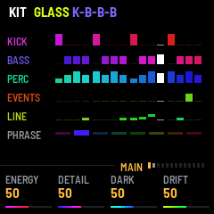

### 5.2 GROOVE

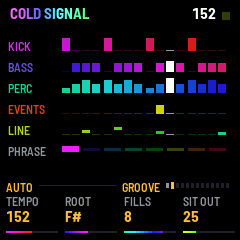

The base of the groove: the speed, the root, the fills and the percussion's rests.

- TEMPO (default: the world's): the speed, shown in beats per minute. It moves the world's own tempo by up to 20 faster or slower.
- ROOT (default: the world's): the note the bass and the kick are built on, shown by name. It moves it up to five semitones down and six up.
- FILLS (default 8): how often the last beat of a bar turns into a fill, with the bass resting and a clap rolling up, and how often a
  phrase ends in a twist of the kick. OFF, or every 32, 16, 8 or 4 bars. That is the usual distance; for a while it may be
  halved or doubled, more often with DRIFT higher. The fills always fall on the ends of 4, 8, 16 or 32 bars.
- SIT OUT (default 25): how often one of the percussion (the hats, the open hat, the clap, the ride) rests for a whole phrase.
  At 0 never.

ALGORITHM picks the shape of the bass. The new shape begins from the next bar.

| Shape | How it plays |
| --- | --- |
| AUTO | Left to the world: the kick on each beat and the bass rolling in the three sixteenths after it, and now and then a gallop, an offbeat, or a bar of triplets in the worlds that have them. |
| K-B-B-B | Holds the roll. |
| GALLOP | Holds a gallop. |
| OFFBEAT | Holds an offbeat. |

### 5.3 BREAK

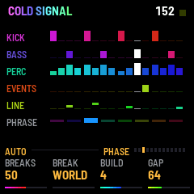

The breaks: how the music moves through breaks, builds and drops by itself, and how its sounds change by
themselves. Press SAVE and ARP to call them yourself (see 8.
Sections).

- BREAKS (default 50): how often a break comes on its own. At 0 it says CUED: a break comes only when you call it. Higher is more
  often, and DRIFT scales it.
- LENGTH (default WORLD): how long a break that comes on its own usually lasts. WORLD leaves it to the world; or 4, 8, 16 or 32 bars.
  Now and then a break is half or twice as long, more often with DRIFT higher.
- GAP (default 64): the fewest bars between a drop and the next break that comes on its own: 32, 64, 96 or 128. After some drops it
  is one step shorter or longer, more often with DRIFT higher.
- MORPH (default 40): how often the kit changes by itself, as if you turned ALGORITHM on MAIN: one part or a few take another type.
  It can happen at a drop, and, in a groove that runs long, every 32 bars, half as often. Higher is more often and more
  parts at once; the header says what changed. At 0 the kit changes only when you turn ALGORITHM.

### 5.4 BUILD

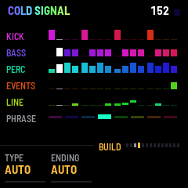

What kind of build comes, and how it ends. Every build has its riser.

- TYPE (default AUTO): the kind of build. AUTO chooses one of the others each time, leaning on the world's habits and never the same
  one twice running.
- ENDING (default AUTO): what happens in the build's last bar (in FAKE, the bar before its short drop). AUTO chooses one of the others
  each time, never the same one twice running.
- LENGTH (default 4): how long a build usually lasts: 2, 4 or 8 bars. Now and then a build is one step longer, and more rarely one
  step shorter, both more often with DRIFT higher.

While a build plays, the left of the rule says `NOW` and the type and ending it is playing, so you can tell what AUTO
chose.

| TYPE | How it plays |
| --- | --- |
| ROLL | The kick and the bass drop out and a clap rolls: quarters, then eighths, then sixteenths. |
| KICK | The kick rolls the same way, rising an octave; the bass is out. |
| FILTER | The kick stays, the percussion comes in from its second quarter and the bass from its half, thinned from below, and the hats get harder. |
| TRIPLET | A clap rolling in quarters, then eighth triplets, then sixteenth triplets, rising. |
| STUTTER | The groove goes on, repeated in smaller and smaller slices: a quarter, an eighth, a sixteenth, a 32nd. |
| POLY | The kick on dotted eighths against the bar, closing to dotted sixteenths and then sixteenths, with the clap on 2 and 4. |
| SINK | The other way: a clap rolling sixteenths, eighths, quarters, slowing and falling, the rest closing from above. |
| FAKE | A ROLL, then a drop for a beat that is cut short, then a bar of the clap's sixteenths before the real drop. |
| HALF | The groove drops to half time, the kick on 1 and 3 and the clap on 3, and the drop snaps back to full speed. |
| ACID | The kick drops out and the bass plays alone on every sixteenth, an octave up on every third, its bite opening wider and wider until it screams. The hats tick on the offbeats. |
| STAIRS | The groove goes on, and the bass, the line and the atmosphere climb a minor third at each quarter of the build. |
| GATE | The groove goes on, chopped: quarters, then eighths, sixteenths and 32nds, only the first half of each heard. |

| ENDING | How it plays |
| --- | --- |
| BREATH | The last beat is silent. |
| RUSH | No silence. The roll goes twice as fast through the last beat, straight into the drop. |
| VOID | The last bar empties, only the riser left, and its last beat is silent. In a 2-bar build, the last two beats. |
| TAPE | The music slows to a stop over the last two beats. |
| REVERSE | The last beat plays the beat before it backwards. |
| ECHO | The third beat is thrown into the echo, and the last beat is silent but for its repeats. |
| PICKUP | The last beat is silent but for its last sixteenth, where the kick and the bass step into the drop. |
### 5.5 AUTO

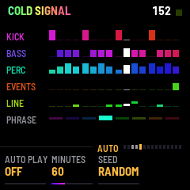

AUTO PLAY plays a whole set by itself, as a DJ would: it goes through the worlds, moves the tempo and
the key, calls the breaks and the builds, and raises and lowers the music along a curve of its own. It plays the effects, takes parts out and brings
them back, and throws sounds as the keys do.

- AUTO PLAY (default OFF): right for ON, left for OFF.
- MINUTES (default 60): how long the set is: 30, 60, 90, or ENDLESS.
- SEED (default RANDOM): which set. Each number from 1 to 99 is a plan of its own: the worlds, the tempos, the keys, where it rises and
  falls. Started from rest, the same number, the same MINUTES and the same tempo plan the same set again; the sounds in it
  still come out different each time. RANDOM picks a number for you, and shows it while the set plays.
- PERFORM (default 50): how much it plays the effects, the parts and the sounds of the keys. At 0 it leaves them all to you (what it
  takes out at a chapter's change, a groove's end and a beginning stays: that is the set's own shape).

Turn it on while the music rests and the set waits at its beginning for PLAY. Turn it on while the music plays and the
set goes on from there. MINUTES and SEED can be turned only while it is off; PERFORM at any time. On MAIN, BREAK and AUTO the rule shows how
long the set has played, as `12:34` (past an hour, `1:02:34`). The rule's line beside it becomes a bar, lit as
far as the set has come, with a mark at each chapter's end. On ENDLESS the bar fills once an hour.

A set is made of chapters of some minutes each, and each plays like a track: a few grooves, each ending its own way. One
of them is the chapter's full break, a long break and a build into the drop; the others end in a short break and a drop
at once, in a build straight from the groove, or in a part taken out or a filter into a drop of their own. The highest chapter
is the set's peak: its break is the longest, and the chapter before it is held back. The set's own beginning comes in
part by part, the line and the events a little after the rest.

A chapter changes to the next in one of three ways, as a DJ goes from one track to the next. Through the full break: the
world and the key come on its drop. Into the next one's break: they come as that break begins. In the groove: the old
chapter thins out (the low end, the bass and the kick going), a drop brings the new world and key, and the new chapter
comes in part by part. The world and the key change at these and nowhere else. The tempo
glides all the way through. The set begins at the tempo it is turned on with: GROOVE's TEMPO while the music rests, the
tempo it plays at while it plays (a MIDI clock's, if one comes). Every later tempo moves as far with it, between 125 and
206 BPM. A set of 30, 60 or 90 minutes ends in a break that fades out, and then the music rests.
ARP in that last break calls the music back: AUTO PLAY turns off and it goes on.

Each chapter has a few sounds of its own and a short motif that comes back through it. The effects and the parts move
mostly at the ends of phrases, and while they do, the effects of the ECHO page (see 7. The performance) are shown in
place of the lanes: the effect is lit, the
part out is dark. The page you are on stays, with its knobs, and so does what the keys do; touch anything and the page's
own picture is back. The keys AUTO PLAY plays
light up as if they were pressed. On the ECHO page, tap a dark part's black key to bring the part back. The atmos is not cut
but slowly faded down and up again, now and then, and its fader on MIX moves with it (see 5.13).

You can play along. What you turn of what the set moves (the four knobs of MAIN, TEMPO, ROOT, BREAKS, the LENGTH of
builds) stays yours for 32 bars, then goes back to the set: the four knobs and TEMPO by degrees, BREAKS and LENGTH at
once, ROOT at the next chapter (turned
just before one, it stays through that one too). A world you
choose with PRESETS stays until the next chapter. Breaks, builds and drops you call are followed (a break you call goes
on to its build after 32 bars at most): a drop you call in the last break or build of a chapter that changes through its break brings the next chapter. Play
an effect yourself
and the set leaves the effects and the parts to you for 32 bars; mute a part, or bring it back, and it leaves that part
alone as long, and takes no part out while any is muted. Turn the atmos's LEVEL and it comes back up, and is left alone
so too. Throw a sound with the keys or press REC and it throws none for 32 bars, nor while REC's loop plays.
Everything else is yours as always.

Turn it off and the music goes on as it is, with the knobs where the set left them. What SAVE keeps during a set is
your own settings, not the set's. When a set has run out, your own come back.

### 5.6 KICK

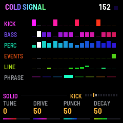

The kick's sound.

- TUNE (default 0): the pitch of the kick, up to six semitones down or up. Shown with a plus above 0.
- DRIVE (default 50): how hard it is driven, from soft and clean to harsh.
- PUNCH (default 50): how sharp the click at its start is.
- DECAY (default 50): the length of its body, from short and tight to long and full.

ALGORITHM picks the type.

| Type | Sound |
| --- | --- |
| SOLID | The world's own. |
| HARD | Falls faster, with a louder click and more drive. |
| KNOCK | Shorter, with wood under the boom. |
| ZIP | Falls from higher and slower, the zip of a dark kick. |
| CRACK | Falls fast and tight, with a burst of bright noise on top, the snap of a hi-tech kick. |

### 5.7 BASS

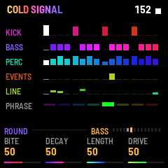

The rolling FM bass's sound.

- BITE (default 50): how hard each note bites at its start, from round to snarling.
- DECAY (default 50): how long that bite stays. Lower is rounder, higher keeps the snarl through the note.
- LENGTH (default 50): how long each note is, from short stabs (a quarter of the world's) to as long as a note can be.
- DRIVE (default 50): how hard the bass is driven.

ALGORITHM picks the type, the bass's colour. Most drops pick another on its own; with DRIFT lower, more of them keep it.

| Type | Sound |
| --- | --- |
| ROUND | Round, the original sound. |
| BITTEN | A strong bite. |
| METAL | Metallic, the overtones off the pitch. |
| HOLLOW | A thick sound, with a ring an octave below mixed in. |
| SNAP | A hard click on each note, round under it. |
| NASAL | A hollow, reedy buzz. |

### 5.8 PERC

The percussion: the hats, the open hat, the clap and the ride.

- HATS (default 50): how loud the closed hats are, and how many of their weak sixteenths play. At 0 there are no hats, and no open hat.
- OPEN (default 50): how long the open hat rings, from a quarter to four times the world's.
- CLAP (default 50): how loud the clap on 2 and 4 is. At 0 there is none.
- TONE (default 50): below 50 the whole percussion darkens, and at 0 it is muffled; above 50 the hats thin out and the clap's band
  rises. 50 is as it is.

ALGORITHM picks the type.

| Type | Sound |
| --- | --- |
| HISS | The world's own. |
| TIN | Rings longer, a small cheap cymbal. |
| TICK | Short and thin, dry ticks. |
| GRIT | The noise held in steps, dust in the machine. |
| SEED | A narrow, lower band of noise that swells in slowly and crackles in sparse grains, a shaker's seeds. |

### 5.9 EVENTS

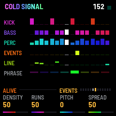

The events are the one-shot sounds that dark psy and hi-tech are made of: zaps, gurgles, dives, growls,
chirps, lasers, single or in runs (a staircase of pitches, a roll). The music keeps a loop of four bars of them on the
offbeats, and some of them change each phrase. What you throw from the keys goes in beside them (see 6. The keys).

- DENSITY (default 50): how many there are.
- RUNS (default 50): how many of them are runs, instead of single sounds.
- PITCH (default 0): the pitch of all of them, up to a whole octave down or up.
- SPREAD (default 50): how wide they are in the stereo field. At 0 everything is in the middle; at 50 each is as it was made; towards
  100 they go far to the sides, and each one crosses from one side to the other.

ALGORITHM picks the type.

| Type | Sound |
| --- | --- |
| ALIVE | The sounds as they are. |
| METAL | Struck sheet and wire. |
| LIQUID | Things under water, wobbling slower and deeper. |
| SHARD | Short and harsh, broken glass or a machine's fault. |
| GHOST | Played backwards, swelling out of nothing and cut at their height, a sound sucked in. |
| RATCHET | Chopped on and off twenty to thirty times a second and made to last longer, a machine's teeth. |

### 5.10 LINE

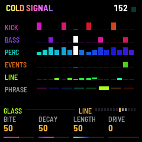

The line is a phrase that repeats, two bars of sixteenths, played high over the bass. It comes in after the
intro, and as each phrase begins it plays or rests: some worlds keep it nearly always, some seldom. Its notes are
drawn at random from the world's scale, and its movement is on LINE SEQ.

- BITE (default 50): how hard each note bites at its start, from muted to bright.
- DECAY (default 50): how fast that bite fades, from quick to a long swell.
- LENGTH (default 50): how long each note is, from clipped to long.
- DRIVE (default 0): how hard it is driven. At 0 it is clean.

ALGORITHM picks the type.

| Type | Sound |
| --- | --- |
| ACID | The world's own. |
| GLASS | Softer and ringing, a struck glass. |
| GROWL | Deeper, swinging and driven, a throat. |
| REED | Buzzes steadily, with a bite that does not fall. |
| BEND | Drops into each note from a fifth or so above, rubbery. |
| CRUSH | Breaks the sound into coarse steps, a broken machine. |

Hold LFO on this page and the phrase is drawn anew from the next bar. The message is `NEW PHRASE`.

### 5.11 LINE SEQ

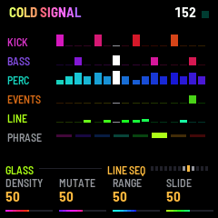

The line's phrase itself. Its 32 steps show at once, so you hear a change straight away.

- DENSITY (default 50): how many of the 32 steps sound, leaning to the offbeats.
- MUTATE (default 50): how many steps are rewritten every four bars. DRIFT adds to it.
- RANGE (default 50): how high the notes reach. At 0 they stay on the root; at 100 they reach twice the world's range.
- SLIDE (default 50): how many notes slide into the next.

ALGORITHM picks the type, as on LINE. Holding LFO draws the phrase anew here too (`NEW PHRASE`).

### 5.12 ATMOS

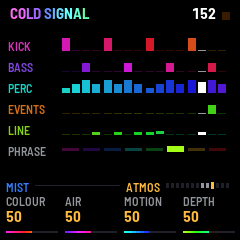

The atmosphere: a held chord under the music, each note a little apart left and right, with a band of
noise wandering beside it. It is quiet under the groove, as quiet as the world has it, and comes up in a break and
down again after the drop.

- COLOUR (default 50): from dark and hollow to bright and open. It opens by itself as a build rises.
- AIR (default 50): how much of the wandering noise there is.
- MOTION (default 50): how fast the chord sways, from one sway in about 80 seconds to nearly one a second. Past 50 the sway also
  opens and closes the sound.
- DEPTH (default 50): how far it sways.

ALGORITHM picks the type.

| Type | Sound |
| --- | --- |
| MIST | The world's own, soft. |
| CHIME | Brighter, bells far off. |
| DRONE | Deeper and darker, a slow beating hum. |
| GRAIN | Breaks the chord into grains with more air, a forest's crackle. |
| PULSE | Cuts the chord in time with the music, in a pattern of sixteenths, a pad that breathes with the groove. |

### 5.13 MIX

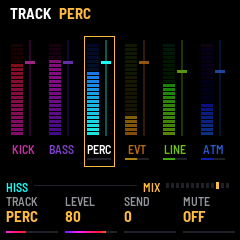

The mixer. A strip for each of the six parts. A strip's meter lights as the part sounds. Beside it is its level, a thin slot
with a cap, and under its name is a short bar for its send into the echo. The track the knobs act on is framed. A
muted part is dark. ALGORITHM picks that track's type, as on the part's own page, and its name shows at the left of the
rule.

- TRACK (default KICK): which part the next three knobs act on: KICK, BASS, PERC, EVENTS, LINE, ATMOS (EVT and ATM on the strips).
- LEVEL (default 80 for the kick, bass, percussion and events; 70 for the line and the atmosphere): its level.
- SEND (default 0 for the percussion; 50 for the events, the line and the atmosphere): how much of it goes into the echo. The kick and the bass have none: the knob is blank.
- MUTE (default OFF): turn right to mute the part, left to bring it back. It is the same as the black keys on ECHO (see 7. The
  performance).

### 5.14 ECHO

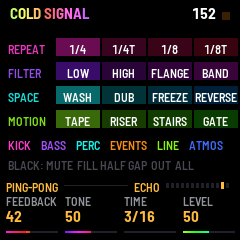

The echo that the parts' sends go into, and the performance on the keys. On this page the keys are not
for events: see 7. The performance.

- FEEDBACK (default 42): how long the echoes go on.
- TONE (default 50): how dark or bright the repeats are.
- TIME (default 3/16): the length of one repeat, as a musical value: 3/16, 1/8, 1/4T or 3/32.
- LEVEL (default 50): how much of the echo comes back.

ALGORITHM picks the kind of echo.

| Type | Repeats |
| --- | --- |
| PING-PONG | Repeat left and right in turn. |
| STRAIGHT | Both repeats in the middle. |
| TAPE | Wavers, darker and slightly driven. |
| SMEAR | Blurs each repeat more, towards a reverb. |

### 5.15 GLOBAL

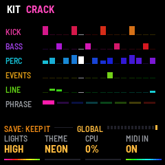

The settings for the screen and the buttons, and the page to save from (see 10. Saving).

- LIGHTS (default LOW): the glow of the buttons: OFF, LOW or HIGH.
- THEME (default NEON): the colours of the screen and how they move.
- CPU: how much of its time the audio is using, in percent. It is only a reading; the knob does nothing. If it says,
  for example, `83%!`, the music came close to what the FM-1 can compute, and it has made the sound a little simpler
  for a few seconds.

| THEME | Colours and motion |
| --- | --- |
| NEON | All the hues. |
| ACID | Yellow to green, quick: swaying fast and wide, with a jolt on each beat. |
| INFRA | Red to magenta, heavy: slow, and a drop's jump twice as far. |
| ICE | Cyan to blue, pale and still: slow and shallow, and a build hardly turning. |
| MONO | White and grey, no hue. |

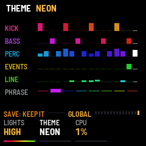

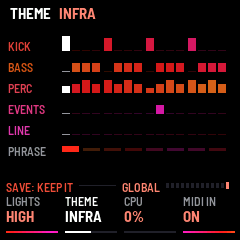

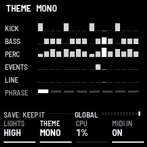

---

## 6. The keys

The keys don't play notes. Each one throws a one-shot sound into the music, the way the music's own events are made,
and the screen names it at once, at the lower right. This is true on every page but ECHO (see 7. The performance).

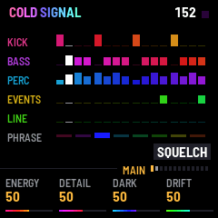

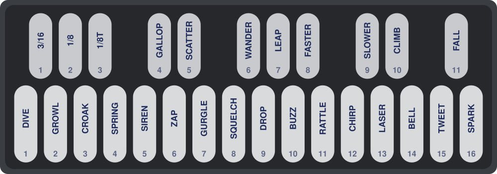

The white keys and the black keys are each numbered from the left (white key 1 is F3, black key 1 is F#3).

**The white keys.** There are 16, and each has its own sound (see the picture).
A sound starts on the next sixteenth, from the pitch of the key. Press harder, or
land harder, and it bites more. Hold the key and it repeats on every sixteenth, the sound
turning a little each time round. One sound plays at a time: press another key and it takes over from the one before.
What you throw is remembered, and now and then the music's own events take it up.
With ALGORITHM on the EVENTS page you change the type of all of them (see 5.9).

**The black keys.** There are 11. Hold one and it becomes a rhythm: the white key held with it throws on its
beats instead of on every sixteenth. The eighths, the triplets and the thirty-seconds fall on their own places in the beat, and GALLOP
and SLOWER on their own places in the bar.
WANDER, SCATTER and LEAP move the pitch: each time you press one, it makes up a new run of notes, and plays it again
every bar for as long as you hold it. Held alone, it makes no sound. Let go and the sixteenths come back. The name of the rhythm shows to the left
of the event's name.

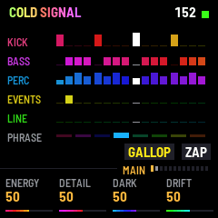

| Black key | Rhythm |
| --- | --- |
| 1 | 3/16: dotted eighths |
| 2 | 1/8: eighths |
| 3 | 1/8T: eighth triplets |
| 4 | CLIMB: sixteenths climbing a minor third each time, eight steps |
| 5 | FALL: the same, falling |
| 6 | WANDER: sixteenths, stepping up and down the scale |
| 7 | SCATTER: sixteenths, jumping anywhere within an octave |
| 8 | LEAP: eighths, leaping between the root, the fifth and the octaves |
| 9 | SLOWER: quarters, once a beat |
| 10 | FASTER: thirty-seconds, twice as fast as the sixteenths |
| 11 | GALLOP: x.xx on each beat |

**OCT− and OCT+** move the octave of all of it, from one octave down to two up. The header says OCTAVE and the
number.

**REC.** Tap REC and it waits for the next bar: the rule says `REC: NEXT BAR` and REC blinks quickly. From that bar
REC blinks on the beats and what the keys throw goes into a loop, each where it fell; the rule counts the bars,
`REC: BAR 1/4` up to `4/4`. A key played just before the bar begins counts as its first. After four bars the loop plays
on, again and again, and REC is lit. Tap REC while it takes and the take ends with that bar: the loop is as many bars
as you played, one to four (the message says how many, `2 BARS`), and the rule's count shows where it will end. A
loop of three bars drifts against the groove's fours.

Tap REC again for a new take: from the next bar the old loop is gone and the new one is taken. Tap it while it waits
and it doesn't (`OFF`). Hold REC and the loop is gone (`CLEARED`). Resting with PLAY clears it too.

---

## 7. The performance

On the ECHO page (FX) the keys are the performance instead of events. The screen shows the grid.

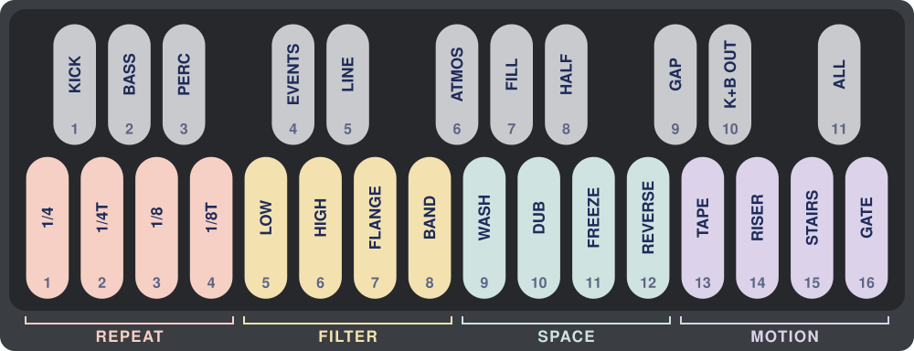

**The white keys: 16 effects.** The white keys, low to high, fill the grid on the screen row by row, four rows of four. Each works
over the whole mix while its key is held, and stops when you let go. The first key of each row glows, to mark the rows.

| White key | Row | Effect | What it does |
| --- | --- | --- | --- |
| 1 | REPEAT | 1/4 | A quarter note of the music repeated, from the next beat. |
| 2 | REPEAT | 1/4T | A quarter-triplet of it, from the next beat. |
| 3 | REPEAT | 1/8 | An eighth, from the next sixteenth. |
| 4 | REPEAT | 1/8T | An eighth-triplet, from the next sixteenth. |
| 5 | FILTER | LOW | The sound slides down to dark. |
| 6 | FILTER | HIGH | The sound slides up and thins out. |
| 7 | FILTER | FLANGE | A short swept delay. |
| 8 | FILTER | BAND | A telephone's narrow sound. |
| 9 | SPACE | WASH | Everything but the kick and the bass goes into a great hall. It has no repeats, only a cloud, and their own sound sinks to less than half. Let go and the music is back, and the hall dies away over a few seconds. |
| 10 | SPACE | DUB | Everything but the kick and the bass goes into the echo, its return lifted, its own sound sunk by a third. The echo is darker and longer, its time stretching slowly and wavering like a tape, its pitch sinking. Let go and it springs back. |
| 11 | SPACE | FREEZE | The music above the kick and the bass is taken into the echo for one echo's time, then looped there, with nothing more going in and its own sound sinking beneath. It lifts the echo's return to most of its height, even if ECHO's LEVEL is low, and the return falls back over about two seconds after. |
| 12 | SPACE | REVERSE | The last beat, backwards. |
| 13 | MOTION | TAPE | The music slows to a stop over two beats. |
| 14 | MOTION | RISER | A band of noise rising over two bars. |
| 15 | MOTION | STAIRS | One sixteenth again and again, a minor third higher each time, up to two octaves. |
| 16 | MOTION | GATE | What is above the kick and the bass is cut in sixteenths. Their echo goes on. |

REPEAT's four, REVERSE, TAPE and STAIRS take turns, and the last one you press plays. The rest add up, and you can hold
as many as your fingers allow.

**The black keys: 11, the parts.** The screen's strip under the grid names them in order, and the line under it
names the rest.

| Black key | What it does |
| --- | --- |
| 1 | KICK mute. Tap to mute, tap again to bring it back. |
| 2 | BASS mute. |
| 3 | PERC mute. |
| 4 | EVENTS mute. |
| 5 | LINE mute. |
| 6 | ATMOS mute. |
| 7 | FILL: the next beat is a fill, with the bass resting and a clap rolling up. |
| 8 | HALF: while held, half time. The kick lands on 1 and 3, and the bass rolls in eighths. |
| 9 | GAP: the last beat to come in a bar is silent, all of it. Use it before a drop. |
| 10 | KICK+BASS OUT: while held, the kick and the bass are out, as in a break. |
| 11 | ALL: every muted part is back. |

A muted part's name is struck through on the screen, and its black key goes dark. It is the same as MUTE on MIX.

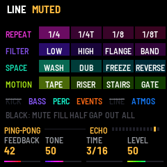

---

## 8. Sections

The music moves through sections by itself, and you can call them. There are three. The groove is the main part. A
break takes the kick, the bass and the percussion out, brings the atmosphere up and thins the events, and the line goes
softer. A build comes after it, for a few bars, one of several kinds (see 5.4). Then the drop: on a bar's first beat
everything is back, with a crash. After a drop the bass is most often another of its types, the events' loop and the line's
phrase are drawn anew, and the colours jump. The music never comes back exactly as it was.

**By itself.** If BREAKS is above 0 and DRIFT is above 0, a break may come as a block of 32 bars begins, and not
sooner than about GAP bars after the last drop. It lasts as many bars as LENGTH on BREAK sets (or the world's own), then
a build, then the drop come on
their own. How likely it is depends on BREAKS and DRIFT together: at the defaults, about once in three blocks. See 5.3.
During AUTO PLAY the set calls them (see 5.5).

**You call them.** All of them wait for the next bar, and they work only while the music is playing.

- SAVE: a break, from the groove. In a break or a build it only says where you are. SAVE is lit while one is cued and
  while a break lasts. A break you call stays until you call the build.
- ARP tapped: a build, from the groove or a break. In a build, the drop, at the next bar. ARP is lit while the cue
  waits, and flashes on the beats through a build.
- ARP held for half a second: the drop, at the next bar, from wherever you are.

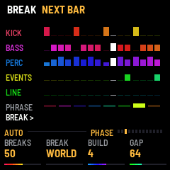

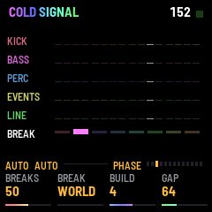

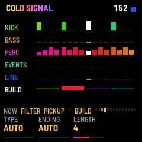

---

## 9. Worlds

PRESETS picks the world. Each is a place with its own tempo, root, bass and percussion, its own one-shot sounds and
line, its own atmosphere and its own breaks. The change begins from the next bar. The world's name is in the header.
Every knob works inside the world, and none of them is moved by the choice. Eight, slow and wet to fast and fine.

| World | Tempo | Root | Break | Character |
| --- | --- | --- | --- | --- |
| SWAMP RADIO | 145 | F | 16 bars | Low and muffled: a soft stuttering bass, wet clicks, a thick murmur. The atmosphere is loud and the line seldom plays. |
| UNDER THE ROOTS | 148 | E | 24 bars | Deep and long: a thick low bass, a growl now and then, sinking sounds, a dark swell. |
| COLD SIGNAL | 152 | F# | 16 bars | Cold dark psy: hard short sixteenths, a short line creeping in semitones, lasers, a thin band of noise. This is the world you start in. |
| RUBBER CIRCUS | 156 | G | 8 bars | Bouncing: the bass jumps now and then, a talking line, gurgles, sudden turns. Now and then a bar of triplets, and more gallops. |
| BLACK UNDERTOW | 160 | E | 16 bars | Heavy: a distorted bass, a long dragging line, groans. Big breaks. |
| COPPER NERVE | 168 | F | 8 bars | Tight: a short metallic repeat, the staircases begin, a ride on the eighths, and a bar of triplets fairly often. |
| GLASS INSECTS | 176 | F# | 8 bars | Bright hi-tech: clean sixteenths, a bright metallic line, staircases flying left and right, a ride. Short breaks. |
| CHROME SWARM | 186 | G | 4 bars | Fast and fine: the detail in the line's fragments and in the events, the densest world, changing all the time, a ride, and almost no atmosphere in the groove. |

---

## 10. Saving

On GLOBAL, tap SAVE to keep everything: the world, every knob of every page, Lights and Theme. They come back
the next time the FM-1 starts. While something is not saved, the rule there says `SAVE: KEEP IT` and SAVE stays lit, and the header says
`SAVED` when it is done, or `SAVE FAILED` if it could not be. Elsewhere SAVE calls a break (see 8. Sections), so go to GLOBAL to save.

The types and shapes that ALGORITHM picks, the muted parts, the octave, the keys' loop and AUTO PLAY being on are not saved: the music
starts each time with the world's own sounds. If a newer version changes what is kept, the first start after the update
may come back with the defaults.

**Back to the defaults.** On GLOBAL, hold SAVE for 1.5 seconds. Every knob of every page goes back to where it began
(tempo and root to the world's own). The world, Lights and Theme stay. The header says `DEFAULTS`. This is not kept until
you tap SAVE.

---

## 11. MIDI

MIDI in is always on. It listens on USB and the TRS jack, on any channel. With a DAW or another device connected, it
follows the clock, start and stop that come from it too: turn off their sending if you don't want that.

- Notes: a note throws the sound of the key it matches, as the key would (see 6. The keys), on every page: on ECHO
  too, where the notes throw sounds while the keys play the effects. The keys are F3 to G5 (MIDI
  notes 53 to 79). A note outside them is folded in by octaves. A note's velocity counts, and note off ends a held note.
  The black keys' rhythms work too.
- Start: plays from the top. If it is already playing, it begins again from the top.
- Continue: plays.
- Stop: rests.
- Clock: the tempo follows it, between 125 and 220 BPM. The header shows the tempo it follows, and the TEMPO knob is
  moved aside. Only the speed is followed, not where the beat lies. When the clock stops, the world's tempo comes back.
  AUTO PLAY follows the clock's tempo too, while there is one.

Start, continue and stop also end the logo's silence at once (see 2. Starting up).

---

## 12. USB audio

Over the USB cable the FM-1 appears as an audio input on your computer. You can record the music from it, with any
recorder.

---

## 13. Troubleshooting

If you hear nothing, check that PLAY is lit and that MASTER is up. The logo is silent while it shows. A part may be muted
(see 7. The performance). A break takes the kick, the bass and the percussion away for a while (see 8. Sections).

If the colours seem lost, check THEME on GLOBAL: MONO has no colour.

If the CPU reads `%!`, the music has made itself lighter for a while (see 5.15).

If the installer doesn't find the FM-1, use Chrome or Edge, allow MIDI when the browser asks, and close any other
programs that use the FM-1's MIDI port.

To go back to M-VAVE's own firmware, use the installer's last section, which writes it back. If the FM-1 doesn't
start after an install, it starts in a safe mode after two failed starts, and the installer can reach it from there.

---

## 14. Licence

RhinoTiger is GPL-3.0-only. It is built on fm1-base (MPL-2.0) and felucca-bsp, which come from Felucca by Leo
Kuroshita, Hügelton Instruments, and it was started from fm1-base's template by Charles Vestal. The logo's
characters were drawn from Noto Sans JP Black (SIL Open Font License 1.1). The source is at
https://github.com/hacha/rhinotiger.

M-VAVE and FM-1 are trademarks of their owners. RhinoTiger is not affiliated with M-VAVE.
