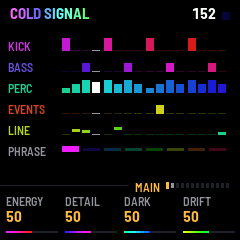
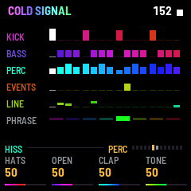
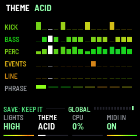
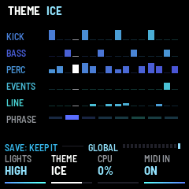
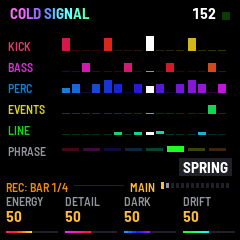
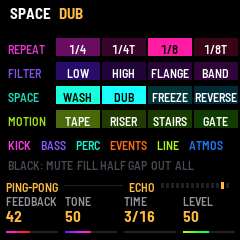

# RhinoTiger

[日本語](MANUAL.ja.md)

RhinoTiger is a generative psytrance firmware for the M-VAVE FM-1, from dark psy to hi-tech. It plays by itself. You
steer it: four macro knobs, a mix with mutes, and a keyboard that throws one-shot sounds into the music. A kick, a
rolling FM bass, percussion, a repeating line, one-shot sounds and a held atmosphere play on a grid of sixteenths.
Eight worlds, slow and wet to fast and fine, decide how it all behaves.

---

## Contents

1. Install
2. Starting up
3. The screen
4. Controls
5. The pages
6. The keys
7. The performance
8. Sections
9. Worlds
10. Saving
11. MIDI
12. USB audio
13. Troubleshooting
14. Licence

---

## 1. Install

To try it first, open the emulator. It runs the same code in your browser, with sound.

To install it from the browser, use Chrome or Edge. Connect the FM-1 by USB, open the installer and press Install.
The browser asks once to allow MIDI, so allow it. Don't unplug the cable while it writes.

To install it from a terminal, run `python3 tools/fm1_install.py rhinotiger-VERSION.fwsc`, with the package that
goes with the version you downloaded.

RhinoTiger keeps only its own settings. It doesn't read what another firmware saved (projects, presets, samples),
and that may not be there when you go back to it, so back it up first.

You install it at your own risk. To go back to the stock firmware, use the installer's last section, which writes
M-VAVE's own firmware back.

---

## 2. Starting up

When the FM-1 starts, the logo shows: a face behind, the two characters 犀 and 虎 on it, and a band across the middle
with RHINOTIGER in it. They come one by one and stay a moment, about two and a half seconds in all. The sound is
silent until they are gone. Then the music starts at once, from the top, with the settings you saved (see 10.
Saving).

You don't have to wait for it. Press PLAY while the logo is up and the music starts at once. Turning the knobs and
pressing the keys already works during the logo.

The music starts sparse. Over the first bars the parts come in one by one: the kick, the bass and the hats first, then
the open hat, the clap, the line and the rest, and after about 24 bars it is all there (some 40 seconds, depending on
the world; see 9. Worlds).

Press PLAY again and it rests at once. Press it once more and it begins again from the top, sparse as before.

---

## 3. The screen

At the top is the header. It holds the name of the world (see 9. Worlds), which drifts through colours while the
music plays and turns grey while it rests; the tempo in beats per minute; and a small lamp that blinks on the beat,
white on the first beat of a bar. For a moment after you do something (turn a knob, press a button), the header says
what happened instead.

At the bottom are the four knobs, each with its name, its value and a thin bar. A knob you have just turned lights
up. Above them runs a rule, and on the rule sits a short strip: the name of the page you are on, and a row of 13 small
bars, one for each page, with the shown one lit. Turn SELECT to walk through the pages one by one, or press a button to
jump to its page. At the left of the rule is whatever the page can be set to by ALGORITHM, shown by name (see 4.
Controls), or what needs saying: `REC: THE KEYS` while REC is held, and `SAVE: KEEP IT` on GLOBAL when something is not saved.

Between the two is the page itself. On most pages it is the same picture, the lanes. There are five rows, KICK,
BASS, PERC, EVENTS and LINE, and each shows the bar that is playing, one cell for every sixteenth: a taller block is a
harder hit, a dot is a rest, and a white cell marks the sixteenth sounding now. The line draws its notes by height.
The lane of the part whose page you are on is brightest; a muted part is dark. Under the lanes is a row of eight small
bars, the phrase: eight bars make a phrase, and the one playing is lit. In a break or a build it counts that section's
bars instead (see 8. Sections), and when a section is cued, `BREAK >`, `BUILD >` or `DROP >` waits there until the
next bar. When you throw an event from the keys, its name appears at the lower right (see 6. The keys).

Two pages have a picture of their own. On MIX it is the mixer, six strips (see 5.11). On ECHO it is the grid of
sixteen effects and the six parts (see 7. The performance).

The colours move with the music. The hues sway slowly together, sink in a break, spin faster and faster through a
build and jump at the drop. THEME, on the global page, chooses the palette (see 5.13).

Every button glows dim. The button of the page you are on is lit. PLAY is lit while it plays. SAVE is lit on the
global page when something is not saved, and elsewhere while a break is cued or on. ARP is lit while a build or a drop
is cued, and flashes on the beats during a build. OCT− is lit while the keys' octave is below 0, OCT+ while it is above. REC is lit
while the keys' loop plays. Lights, on the global page, sets how bright the glow is.

---

## 4. Controls

| Control | What it does |
| --- | --- |
| SELECT | Turns through the 13 pages in order, from MAIN to GLOBAL. It stops at the ends. |
| HOME | Goes to MAIN. Press again for GROOVE. Press again to go back. |
| SEQ | Goes to PHASE: the sections. |
| SEL | Goes to KICK. Press again for BASS. Press again to go back. |
| ENV | Goes to PERC. Press again for EVENTS. Press again to go back. |
| LFO | Goes to LINE. Press again for LINE SEQ. Again for ATMOS. Again to go back. On LINE and LINE SEQ, hold it for half a second and the line's phrase is drawn anew from the next bar, instead of moving on. |
| EDIT | Goes to MIX. |
| FX | Goes to ECHO: the echo, and the performance on the keys. |
| GLO | Goes to GLOBAL. |
| PRESETS | Picks the world. Eight worlds. The new one begins from the next bar. |
| ALGORITHM | Picks a type, for the page you are on (see below). |
| K1 to K4 | The four knobs of the page that is shown. Knobs that run from 0 to 100 move two at a step. |
| PLAY | Plays, or rests. After a rest it begins again from the top. |
| SAVE | On GLOBAL: tap to keep everything, hold for 1.5 seconds for the defaults (see 10. Saving). On other pages: calls a break (see 8. Sections). |
| ARP | Calls a build, then the drop (see 8. Sections). |
| REC | Hold it and what the keys throw is taken into a loop of two bars (see 6. The keys). |
| OCT− · OCT+ | Move the octave of the keys' sounds, one octave at a time, from one down to two up. OCT− lights while it is below 0, OCT+ while it is above. |
| MASTER | The volume. |
| Keys | Throw sounds into the music. On the ECHO page they are the performance instead. |

ALGORITHM does something different on each page. On MAIN it takes the kit: forward, one part, or a few of the parts
that are sounding, take another type from the next bar, and the more you turn in a bar the more change (up to three
parts); back, the kit before, up to eight steps. On GROOVE it picks the shape of the bass. On PHASE it picks the kind
of build. On ECHO it picks the kind of echo. On KICK, BASS, PERC, EVENTS, LINE, LINE SEQ and ATMOS it picks the type of
that part, one of four to six, and the new type begins from the part's next note. On MIX it picks the type of the
track TRACK has chosen. On GLOBAL it does nothing. The name
of the choice shows at the left of the rule. Types and shapes are listed on the pages they belong to. They are not
saved (see 10. Saving).

---

## 5. The pages

There are 13. The four knobs always belong to the page you are on. Each knob is listed with what you hear as it turns
and the value it starts at. A part's level and its send into the echo are on MIX only.

### 5.1 MAIN

HOME. Four macros. Each leans several things in the music at once, and each is neutral in the middle: at 50 the
world is as it is.

- ENERGY: busier or sparser. Higher brings more one-shot sounds, a livelier line and more hats, and fewer parts sitting out (see
  GROOVE). Lower thins it. 50.
- DETAIL: finer or plainer. Higher brings more runs in the one-shot sounds, longer, and quicker at the top, and now
  and then a quick double hit on the hats. Lower leaves them single. 50.
- DARK: darker and stranger, or brighter and plainer. Higher darkens the bass, leans the one-shot sounds to the low and
  the middle, brings in harsher notes and lets the line creep and reach higher. Lower is lighter and more open. 50.
- DRIFT: how much changes by itself. Higher redraws more of the one-shot sounds at each phrase, lets the bass open and
  close further, rewrites more of the line, lets breaks come on their own more often (see 8. Sections), lets FILLS,
  BUILD, BREAK and GAP stray more often from their lengths to the next one down or up (see GROOVE and PHASE). At 0 nothing
  moves by itself, no break comes on its own, and those lengths are exact; higher, the bass changes its type at more
  of the drops. 50.

ALGORITHM turns the kit. What it changed shows in the header for a moment, each type in the colour of its part.

### 5.2 GROOVE

HOME again.

- TEMPO: the speed, shown in beats per minute. It moves the world's own tempo by up to 20 faster or slower. The
  world's own.
- ROOT: the note the bass and the kick are built on, shown by name. It moves it up to five semitones down and six up.
  The world's own.
- FILLS: how often the last beat of a bar turns into a fill, with the bass resting and a clap rolling up, and how often a
  phrase ends in a twist of the kick. OFF, or every 32, 16, 8 or 4 bars. That is the usual distance: every 32 bars it
  may become half or twice as long for a while, more often with DRIFT higher, and the fills still fall on the ends of
  4, 8, 16 or 32 bars. 8.
- SIT OUT: how often one of the percussion (the hats, the open hat, the clap, the ride) rests for a whole phrase.
  At 0 never. 25.

ALGORITHM picks the shape of the bass. AUTO leaves it to the world: the kick on each beat and the bass rolling in the
three sixteenths after it, and now and then a gallop, an offbeat, or a bar of triplets in the worlds that have them.
K-B-B-B holds the roll; GALLOP holds a gallop; OFFBEAT holds an offbeat. The new shape begins from the next bar.

### 5.3 PHASE

SEQ. How the music moves through breaks, builds and drops by itself. Press SAVE and ARP to call them yourself (see 8.
Sections).

- BREAKS: how often a break comes on its own. At 0 it says CUED: a break comes only when you call it. Higher is more
  often, and DRIFT scales it. 50.
- BREAK: how long a break that comes on its own usually lasts. WORLD leaves it to the world; or 4, 8, 16 or 32 bars.
  Now and then a break is half or twice as long, more often with DRIFT higher. WORLD.
- BUILD: how long a build usually lasts: 2, 4 or 8 bars. Now and then a build is one step shorter or longer, more often
  with DRIFT higher. 4.
- GAP: the fewest bars between a drop and the next break that comes on its own: 32, 64, 96 or 128. After some drops it
  is one step shorter or longer, more often with DRIFT higher. 64.

ALGORITHM picks the kind of build. AUTO chooses one of the others each time, leaning on the world's habits and never the
same one twice running; in a build, the rule also shows the one it chose.

- ROLL: the kick and the bass drop out and a clap rolls: quarters, then eighths, then sixteenths.
- KICK: the kick rolls the same way, rising an octave; the bass is out.
- FILTER: the kick stays, the percussion comes in from its second quarter and the bass from its half, thinned from
  below, and the hats get harder.
- TRIPLET: a clap rolling in quarters, then eighth triplets, then sixteenth triplets, rising.
- STUTTER: the groove goes on, repeated in smaller and smaller slices: a quarter, an eighth, a sixteenth, a 32nd.
- POLY: the kick on dotted eighths against the bar, closing to dotted sixteenths and then sixteenths, with the clap on 2
  and 4.
- SINK: the other way: a clap rolling sixteenths, eighths, quarters, slowing and falling, the rest closing from above.
- FAKE: a ROLL, then a drop for a beat that is cut short, then a bar of the clap's sixteenths before the real drop.

Every build has its riser, and its last beat is silent.

### 5.4 KICK

SEL.

- TUNE: the pitch of the kick, up to six semitones down or up. Shown with a plus above 0. 0.
- DRIVE: how hard it is driven, from soft and clean to harsh. 50.
- PUNCH: how sharp the click at its start is. 50.
- DECAY: the length of its body, from short and tight to long and full. It never runs into the bass's first note. 50.

ALGORITHM picks the type: SOLID is the world's own; HARD falls faster, with a louder click and more drive; KNOCK is shorter,
with wood under the boom; ZIP falls from higher and slower, the zip of a dark kick; CRACK falls fast and tight, with a
burst of bright noise on top, the snap of a hi-tech kick.

### 5.5 BASS

SEL again.

- BITE: how hard each note bites at its start, from round to snarling. 50.
- DECAY: how long that bite stays. Lower is rounder, higher keeps the snarl through the note. 50.
- LENGTH: how long each note is, from short stabs (a quarter of the world's) to as long as a note can be. 50.
- DRIVE: how hard the bass is driven. 50.

ALGORITHM picks the type, the bass's colour: ROUND, BITTEN, METAL, HOLLOW, SNAP (a hard click on each note, round under
it) or NASAL (a hollow, reedy buzz). Most drops pick another on its own; with DRIFT lower, more of them keep it.

### 5.6 PERC

ENV.

- HATS: how loud the closed hats are, and how many of their weak sixteenths play. At 0 there are no hats, and no open hat. 50.
- OPEN: how long the open hat rings, from a quarter to four times the world's. 50.
- CLAP: how loud the clap on 2 and 4 is. At 0 there is none. 50.
- TONE: below 50 the whole percussion darkens, and at 0 it is muffled; above 50 the hats thin out and the clap's band
  rises. 50 is as it is.

ALGORITHM picks the type: HISS is the world's own; TIN rings longer, a small cheap cymbal; TICK is short and thin, dry ticks;
GRIT is the noise held in steps, dust in the machine.

### 5.7 EVENTS

ENV again. The events are the one-shot sounds that dark psy and hi-tech are made of: zaps, gurgles, dives, growls,
chirps, lasers, single or in runs (a staircase of pitches, a roll). The music keeps a loop of four bars of them on the
offbeats, and some of them change each phrase. What you throw from the keys goes in beside them (see 6. The keys).

- DENSITY: how many there are. 50.
- RUNS: how many of them are runs, instead of single sounds. 50.
- PITCH: the pitch of all of them, up to a whole octave down or up. 0.
- SPREAD: how wide they are in the stereo field. At 0 everything is in the middle; at 50 each is as it was made; towards
  100 they go far to the sides, and each one crosses from one side to the other. 50.

ALGORITHM picks the type: ALIVE is the sounds as they are; METAL is struck sheet and wire; LIQUID is things under water,
wobbling slower and deeper; SHARD is short and harsh, broken glass or a machine's fault; GHOST plays them backwards,
swelling out of nothing and cut at their height, a sound sucked in; RATCHET chops them on and off twenty to thirty times
a second and lets them last longer, a machine's teeth.

### 5.8 LINE

LFO. The line is a phrase that repeats, two bars of sixteenths, played high over the bass. It comes in after the
intro, and as each phrase begins it plays or rests: some worlds keep it nearly always, some seldom. Its notes are
drawn at random from the world's scale, and its movement is on LINE SEQ.

- BITE: how hard each note bites at its start, from muted to bright. 50.
- DECAY: how fast that bite fades, from quick to a long swell. 50.
- LENGTH: how long each note is, from clipped to long. 50.
- DRIVE: how hard it is driven. At 0 it is clean. 0.

ALGORITHM picks the type: ACID is the world's own; GLASS is softer and rings, a struck glass; GROWL is deeper, swinging
and driven, a throat; REED buzzes steadily, with a bite that does not fall; BEND drops into each note from a fifth or
so above, rubbery; CRUSH breaks the sound into coarse steps, a broken machine.

Hold LFO on this page and the phrase is drawn anew from the next bar. The message is `NEW PHRASE`.

### 5.9 LINE SEQ

LFO again. The phrase itself. Its 32 steps show at once, so you hear a change straight away.

- DENSITY: how many of the 32 steps sound, leaning to the offbeats. 50.
- MUTATE: how many steps are rewritten every four bars. DRIFT adds to it. 50.
- RANGE: how high the notes reach. At 0 they stay on the root; at 100 they reach twice the world's range. 50.
- SLIDE: how many notes slide into the next. 50.

ALGORITHM picks the type, as on LINE.

### 5.10 ATMOS

LFO a third time. The atmosphere: a held chord under the music, each note a little apart left and right, with a band of
noise wandering beside it. It is quiet under the groove, as quiet as the world has it, and comes up in a break and
down again after the drop.

- COLOUR: from dark and hollow to bright and open. It opens by itself as a build rises. 50.
- AIR: how much of the wandering noise there is. 50.
- MOTION: how fast the chord sways, from one sway in about 80 seconds to nearly one a second. Past 50 the sway also
  opens and closes the sound. 50.
- DEPTH: how far it sways. 50.

ALGORITHM picks the type: MIST is the world's own, soft; CHIME is brighter, bells far off; DRONE is deeper and darker, a
slow beating hum; GRAIN breaks the chord into grains with more air, a forest's crackle; PULSE cuts the chord in time
with the music, in a pattern of sixteenths, a pad that breathes with the groove.

### 5.11 MIX

EDIT. A strip for each of the six parts. A strip's meter lights as the part sounds. Beside it is its level, a thin slot
with a cap, and under its name is a short bar for its send into the echo. The track the knobs act on is framed. A
muted part is dark. ALGORITHM picks that track's type, as on the part's own page, and its name shows at the left of the
rule.

- TRACK: which part the next three knobs act on: KICK, BASS, PERC, EVENTS, LINE, ATMOS. KICK.
- LEVEL: its level. 80 for the kick, bass, percussion and events; 70 for the line and the atmosphere.
- SEND: how much of it goes into the echo. The kick and the bass have none: the knob is blank. 0 for the percussion;
  50 for the events, the line and the atmosphere.
- MUTE: turn right to mute the part, left to bring it back. OFF. It is the same as the black keys on ECHO (see 7. The
  performance).

### 5.12 ECHO

FX. The echo that the parts' sends go into, and the performance on the keys. On this page the keys are not
for events: see 7. The performance.

- FEEDBACK: how long the echoes go on. 42.
- TONE: how dark or bright the repeats are. 50.
- TIME: the length of one repeat, as a musical value: 3/16, 1/8, 1/4T or 3/32. 3/16.
- LEVEL: how much of the echo comes back. 50.

ALGORITHM picks the kind of echo, changing by degrees: PING-PONG repeats left and right in turn; STRAIGHT puts both
repeats in the middle; TAPE wavers, darker and slightly driven; SMEAR blurs each repeat more, towards a reverb.

### 5.13 GLOBAL

GLO.

- LIGHTS: the glow of the buttons: OFF, LOW or HIGH. LOW.
- THEME: the colours of the screen and how they move. NEON.
- CPU: how much of its time the audio is using, in percent. It is only a reading; the knob does nothing. If it says,
  for example, `83%!`, the music came close to what the FM-1 can compute, and it has made itself lighter: the atmosphere plays one
  note instead of three, the events use half their voices, and FLANGE is off. It stays lighter for about eight seconds
  after the last time.
- MIDI IN: ON or OFF. OFF. Turn right for ON (see 11. MIDI).

The themes:

- NEON: all the hues.
- ACID: yellow to green, quick: swaying fast and wide, with a jolt on each beat.
- INFRA: red to magenta, heavy: slow, and a drop's jump twice as far.
- ICE: cyan to blue, pale and still: slow and shallow, and a build hardly turning.
- MONO: white and grey, no hue.

---

## 6. The keys

The keys don't play notes. Each one throws a one-shot sound into the music, the way the music's own events are made,
and the screen names it at once, at the lower right. This is true on every page but ECHO (see 7. The performance).

**The white keys.** There are 16, F3 to G5, and each has its own sound, low to high:

| Key | Sound | Key | Sound |
| --- | --- | --- | --- |
| F3 | DIVE | F4 | SQUELCH |
| G3 | GROWL | G4 | DROP |
| A3 | CROAK | A4 | BUZZ |
| B3 | SPRING | B4 | RATTLE |
| C4 | SIREN | C5 | CHIRP |
| D4 | ZAP | D5 | LASER |
| E4 | GURGLE | E5 | BELL |

F5 is TWEET and G5 is SPARK.

A sound starts on the next sixteenth, so it stays in the groove. It starts from the pitch of the key. Press harder, or land harder, and it bites more. Hold the key and it repeats on every sixteenth, the sound
turning a little each time round. What you throw is remembered, and now and then the music's own events take it up.
With ALGORITHM on the EVENTS page you change the type of all of them (see 5.7).

**The black keys.** There are 11, F#3 to F#5. Hold one and it becomes a rhythm: the white keys held with it throw on its
beats instead of on every sixteenth. Held alone, it makes no sound. Let go and the sixteenths come back. The name of the
rhythm shows to the left of the event's name.

| Key | Rhythm |
| --- | --- |
| F#3 | 3/16: dotted eighths |
| G#3 | 1/8: eighths |
| A#3 | 1/8T: eighth triplets |
| C#4 | GALLOP |
| D#4 | OFFBEAT: the offbeat eighths |
| F#4 | 1/16T: sixteenth triplets |
| G#4 | 3-3-2: over two beats |
| A#4 | FASTER: speeding up over two beats |
| C#5 | SLOWER: slowing down over two beats |
| D#5 | CLIMB: sixteenths climbing a minor third each time, eight steps |
| F#5 | FALL: the same, falling |

**OCT− and OCT+** move the octave of all of it, from one octave down to two up. The header says OCTAVE and the
number.

**REC.** Hold REC and the rule says `REC: THE KEYS`. What the keys throw goes into a loop of two bars, each where it
fell. Let go, and it plays on, again and again; the message is `LOOPING`. REC is lit while a loop plays. Press REC
again and a new take begins, and the old one is gone. Tap REC without playing anything and the loop is gone (`CLEARED`).
Resting with PLAY clears it too.

---

## 7. The performance

On the ECHO page (FX) the keys are the performance instead of events. The screen shows the grid.

**The white keys: 16 effects.** The white keys, low to high, fill the grid on the screen row by row, four rows of four. Each works
over the whole mix while its key is held, and stops when you let go. The first key of each row glows, to mark the rows.
Each fades in and out in a few milliseconds.

*REPEAT.* The music, or the last bit of it, again and again.
- 1/4: a quarter note of the music repeated, from the next beat.
- 1/4T: a quarter-triplet of it, from the next beat.
- 1/8: an eighth, from the next sixteenth.
- 1/8T: an eighth-triplet, from the next sixteenth.

*FILTER.*
- LOW: the sound slides down to dark.
- HIGH: the sound slides up and thins out.
- FLANGE: a short swept delay.
- BAND: a telephone's narrow sound.

*SPACE.*
- WASH: everything but the kick and the bass goes into a great hall. It has no repeats, only a cloud, and their own
  sound sinks to less than half. Let go and the music is back, and the hall dies away over a few seconds.
- DUB: everything but the kick and the bass goes into the echo, its return lifted, its own sound sunk by a third. The echo is darker and longer, its
  time stretching slowly and wavering like a tape, its pitch sinking. Let go and it springs back.
- FREEZE: the music above the kick and the bass is taken into the echo for one echo's time, then looped there, with
  nothing more going in and its own sound sinking beneath. It lifts the echo's return to most of its height, even if
  ECHO's LEVEL is low, and the return falls back over about two seconds after.
- REVERSE: the last beat, backwards.

*MOTION.*
- TAPE: the music slows to a stop over two beats.
- RISER: a band of noise rising over two bars.
- STAIRS: one sixteenth again and again, a minor third higher each time, up to two octaves.
- GATE: what is above the kick and the bass is cut in sixteenths. Their echo goes on.

The repeats, REVERSE, TAPE and STAIRS take turns, and the last one you press plays. The rest add up, and you can hold
as many as your fingers allow.

**The black keys: 11, the parts.** The screen's strip under the grid names them in order, and the line under it
names the rest.

| Key | What it does |
| --- | --- |
| F#3 | KICK mute. Tap to mute, tap again to bring it back. |
| G#3 | BASS mute. |
| A#3 | PERC mute. |
| C#4 | EVENTS mute. |
| D#4 | LINE mute. |
| F#4 | ATMOS mute. |
| G#4 | FILL: the next beat is a fill, with the bass resting and a clap rolling up. |
| A#4 | HALF: while held, half time. The kick lands on 1 and 3, and the bass rolls in eighths. |
| C#5 | GAP: the last beat to come in a bar is silent, all of it. Use it before a drop. |
| D#5 | KICK+BASS OUT: while held, the kick and the bass are out, as in a break. |
| F#5 | ALL: every muted part is back. |

A muted part's name is struck through on the screen, and its black key goes dark. It is the same as MUTE on MIX.

---

## 8. Sections

The music moves through sections by itself, and you can call them. There are three. The groove is the main part. A
break takes the kick, the bass and the percussion out, brings the atmosphere up and thins the events, and the line goes
softer. A build comes after it, a roll and a rising noise, for a few bars. Then the drop: on a bar's first beat
everything is back, with a crash. After a drop the bass is most often another of its types, the events' loop and the line's
phrase are drawn anew, and the colours jump. The music never comes back exactly as it was.

**By itself.** If BREAKS is above 0 and DRIFT is above 0, a break may come as a block of 32 bars begins, and not
sooner than about GAP bars after the last drop. It lasts BREAK bars (or the world's own), then a build, then the drop come on
their own. How likely it is depends on BREAKS and DRIFT together: at the defaults, about once in three blocks. See PHASE, 5.3.

**You call them.** All of them wait for the next bar, and they work only while the music is playing.

- SAVE: a break, from the groove. In a break or a build it only says where you are. SAVE is lit while one is cued and
  while a break lasts. A break you call stays until you call the build.
- ARP tapped: a build, from the groove or a break. In a build, the drop, at the next bar. ARP is lit while the cue
  waits, and flashes on the beats through a build.
- ARP held for half a second: the drop, at the next bar, from wherever you are.

---

## 9. Worlds

PRESETS picks the world. Each is a place with its own tempo, root, bass and percussion, its own one-shot sounds and
line, its own atmosphere and its own breaks. The change begins from the next bar. The world's name is in the header.
Every knob works inside the world, and none of them is moved by the choice. Eight, slow and wet to fast and fine.

- SWAMP RADIO: 145, root F. Low and muffled: a soft stuttering bass, wet clicks, a thick murmur. The atmosphere is loud
  and the line seldom plays. Breaks of 16 bars.
- UNDER THE ROOTS: 148, root E. Deep and long: a thick low bass, a growl now and then, sinking sounds, a dark swell.
  Long breaks of 24 bars.
- COLD SIGNAL: 152, root F#. Cold dark psy: hard short sixteenths, a short line creeping in semitones, lasers, a thin
  band of noise. Breaks of 16 bars. This is the world you start in.
- RUBBER CIRCUS: 156, root G. Bouncing: the bass jumps now and then, a talking line, gurgles, sudden turns. Now and then a bar of
  triplets, and more gallops. Breaks of 8 bars.
- BLACK UNDERTOW: 160, root E. Heavy: a distorted bass, a long dragging line, groans. Big breaks of 16 bars.
- COPPER NERVE: 168, root F. Tight: a short metallic repeat, the staircases begin, a ride on the eighths, and a bar of
  triplets fairly often. Breaks of 8 bars.
- GLASS INSECTS: 176, root F#. Bright hi-tech: clean sixteenths, a bright metallic lead, staircases flying left and
  right, a ride. Short breaks of 8 bars.
- CHROME SWARM: 186, root G. Fast and fine: the detail in the line's fragments and in the events, the densest world,
  changing all the time, a ride, and almost no atmosphere in the groove. Breaks of only 4 bars.

---

## 10. Saving

On GLOBAL, tap SAVE to keep everything: the world, every knob of every page, Lights, Theme and MIDI IN. They come back
the next time the FM-1 starts. The rule says `SAVE: KEEP IT` and SAVE stays lit while something is not saved, and the header says
`SAVED` when it is done. Elsewhere SAVE calls a break (see 8. Sections), so go to GLOBAL to save.

The types and shapes that ALGORITHM picks, the muted parts, the octave and the keys' loop are not saved: the music
starts each time with the world's own sounds. If a newer version changes what is kept, the first start after the update
may come back with the defaults.

**Back to the defaults.** On GLOBAL, hold SAVE for 1.5 seconds. Every knob of every page goes back to where it began
(tempo and root to the world's own). The world, Lights, Theme and MIDI IN stay. The header says `DEFAULTS`. This is not kept until
you tap SAVE.

---

## 11. MIDI

MIDI in is optional: turn MIDI IN on GLOBAL on. It is OFF until you do. It listens on USB and the TRS jack, on any
channel.

- Notes: a note throws the sound of the key it matches, as the key would (see 6. The keys). The keys are F3 to G5 (MIDI
  notes 53 to 79). A note outside them is folded in by octaves. A note's velocity counts, and note off ends a held note.
  The black keys' rhythms work too.
- Start: plays from the top. If it is already playing, it begins again from the top.
- Continue: plays.
- Stop: rests.
- Clock: the tempo follows it, 24 pulses to a beat, between 125 and 220 BPM. The header shows the tempo it follows, and
  the TEMPO knob is moved aside. Only the speed is followed, not where the beat lies. When the clock has been gone for
  half a second the world's tempo comes back. It needs 24 pulses before it takes hold.

Start, continue and stop also end the logo's silence at once (see 2. Starting up).

---

## 12. USB audio

Over the USB cable the FM-1 appears as an audio input on your computer. You can record the music from it, with any
recorder.

---

## 13. Troubleshooting

If you hear nothing, check that PLAY is lit and that MASTER is up. The logo is silent while it shows. A part may be muted
(see 7. The performance). A break takes the kick, the bass and the percussion away for a while (see 8. Sections).

If the colours seem lost, check THEME on GLOBAL: MONO has no colour.

If the CPU reads `%!`, the music has made itself lighter for a while (see 5.13).

If the installer doesn't find the FM-1, use Chrome or Edge, allow MIDI when the browser asks, and close any other
programs that use the FM-1's MIDI port.

To go back to M-VAVE's own firmware, use the installer's last section, which writes it back. If the FM-1 doesn't
start after an install, it starts in a safe mode after two failed starts, and the installer can reach it from there.

---

## 14. Licence

RhinoTiger is GPL-3.0-only. It is built on fm1-base (MPL-2.0) and felucca-bsp, which come from Felucca by Leo
Kuroshita, Hügelton Instruments, and it was started from fm1-base's template by Charles Vestal. The logo's
characters were drawn from Noto Sans JP Black (SIL Open Font License 1.1). The source is at
https://github.com/hacha/rhinotiger.

M-VAVE and FM-1 are trademarks of their owners. RhinoTiger is not affiliated with M-VAVE.
